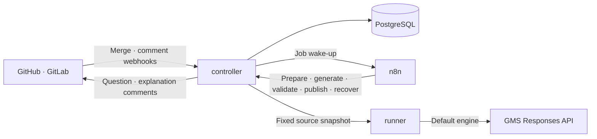

# hey

### hey! 이건 알고 머지한거지? 😏

**A GitHub and GitLab learning bot that turns merged changes into CS questions and explanations.**

When a PR/MR is merged, hey reads the final change and posts **2 basic multiple-choice questions**. Answer in a comment to receive explanations grounded in CS principles and the code. Request **5 follow-up questions** when you want to go deeper.

[한국어](README.md) · [Try it locally](#try-it-locally) · [Comment commands](#comment-commands) · [Install and connect](#install-and-connect) · [Operations guide](docs/operations.md)

## How it works for your team

1. **Merge a PR/MR.** Opening, reopening and pushing do not automatically generate questions.
2. **Answer 2 questions.** Each has A–D options and tests a CS concept relevant to the actual change. Initial questions stay at a basic level.
3. **Read the explanations.** Get the correct option as a sentence, an explanation, per-option notes and links to code at the relevant commit.
4. **Go deeper when needed.** `/hey whatelse` adds 5 deeper questions about the same change.

Questions and replies are written in Korean. hey supports code understanding; it does not find defects automatically, edit code, approve or merge PRs.

### A question preview

This is **one illustrative question**, assuming payment retries reuse the first request's idempotency key. A real initial comment contains two questions.

> #### hey! 이건 알고 머지한거지? 😏
>
> #### Q1. 결제 재시도에 첫 요청의 멱등 키를 사용하는 이유는 무엇인가요?
>
> A. 재시도마다 새 승인을 만들기 위해서입니다.<br>
> B. 동일 요청을 식별해 중복 승인을 막기 위해서입니다.<br>
> C. 주문 저장을 생략하기 위해서입니다.<br>
> D. 모든 재시도를 금지하기 위해서입니다.
>
> ---
>
> 답변 달기: `/hey answer Q1 B`<br>
> 정답·해설 보기: 이 질문 스레드에 답글로 `/hey showanswer`<br>
> 더 풀어보기: `/hey whatelse`

Questions use H4 headings and blank lines. Reference commits appear as a list of **linked commit titles** rather than hashes. Follow-ups start with the first question, without a batch heading or `[심화]` difficulty tag.

Explanations show the correct option's sentence, then **explanation → per-option notes → code evidence**. Notes are indented on a new line beneath each option. Each generated explanation is 1–3 sentences connecting CS principles to concrete code conditions. Your answer and the correct option letters are not displayed side by side.

[Initial question example](docs/examples/initial-questions.md) · [Follow-up and explanation examples](docs/examples/whatelse-with-cs.md)

## Comment commands

Comment on a connected PR/MR. Commands require GitHub Write or GitLab Developer access or higher, and also work on closed or merged PRs/MRs.

| Goal | Comment |
|---|---|
| Get help | `/hey help` |
| Answer one question | `/hey answer Q1 B` |
| Answer several questions | `/hey answer Q1 B Q2 A` |
| Reveal the questions in the comment you reply to | `/hey showanswer` |
| Get 5 follow-up questions | `/hey whatelse` |
| Get up to 5 CS interview questions | `/hey csinterview` |
| Regenerate questions | `/hey tryagain` |
| Ask about the code | `@hey 이 변경에서 멱등성이 필요한 이유가 뭔가요?` |

### Answers and explanations

- Add reasoning after your choice, for example: `/hey answer Q1 B 같은 요청의 승인을 재사용해야 하기 때문입니다`.
- In an inline thread containing one question, a reply such as `B` is enough for grading. Use question numbers in summary comments.
- A choice alone is graded from the stored answer key. If you add reasoning, the model also assesses it.
- `/hey showanswer` reads stored explanations without a model call or marking questions as answered.
- **The question comment you reply to determines the scope.** Reply beneath the initial questions to reveal only those, or beneath a follow-up batch to reveal only that batch. Individual question selectors are not supported.
- Each follow-up batch opens a separate thread. Outside a question thread, the bot asks you to reply to the relevant question comment. It does not guess a scope for older revisions or legacy threads mixing several batches.
- On GitLab, use the question comment's reply field. Ordinary GitHub PR comments have no child replies, so use a **question thread attached to code**. The 5 follow-ups share a separate code thread; an initial inline thread reveals only the one question shown there.

Follow-up numbers continue within the same code version: `심화1–5`, then `심화6–10`. Each PR/MR allows up to 5 follow-up requests per code version. Earlier question and answer history is preserved.

### CS interview preparation

`/hey csinterview` finds CS topics in the actual change and asks four-choice questions about transferable principles, assumptions and distinctions between related concepts. Questions include the necessary conditions and do not require memorizing repository-specific names or constants. Explanations use precise Korean terms, relevant English names or abbreviations, definitions and limits.

- Each batch contains up to 5 questions. Insufficient evidence produces fewer questions or a notice with a reason. Initial questions are not a prerequisite.
- Interview questions have their own `면접1`, `면접2` numbers. Answer with `/hey answer 면접1 B 면접2 C`. Optional reasoning receives feedback on terminology and conceptual confusion; equivalent Korean/English expressions alone are not penalized.
- Reply to the interview question thread with `/hey showanswer` to reveal that batch's stored answers and explanations, without inference or answer credit.
- Numbering and the limit of 5 generated batches per PR/MR code version are independent of supplementary questions. Interview questions do not add merge-gate requirements.

The [interview question and explanation example](docs/examples/csinterview.md) uses fixtures without model calls. Generation instructions and structural validation do not guarantee semantic correctness.

## Try it locally

You need **Node.js 22+, npm and Git**. Running the server or integration tests also requires **Docker Compose, or Colima with Docker Compose available**.

Generate sample comments without API keys or external accounts:

```sh
git clone https://github.com/thisis-joe/codereviewbot.git
cd codereviewbot
npm ci --ignore-scripts
npm run demo
```

Open the generated files below. The demo uses fixtures and makes no model calls.

| Generated file | Content |
|---|---|
| `.local/demo-report.md` | Initial question comment |
| `.local/demo-inline.md` | A question attached to a code line |
| `.local/demo-learning.md` | 5 follow-ups and a graded explanation |
| `.local/demo-csinterview.md` | CS interview questions and thread-scoped answer reveal |
| `.local/demo-help.md` | Full command help |

## Install and connect

### 1. Prepare local configuration

```sh
node scripts/setup.mjs
```

This prepares `.env` with internal tokens and database passwords, and `config/repositories.yaml` with example connections. Existing values are preserved. External repository connections are disabled by default.

Set your issued GMS key in `.env`:

```dotenv
MODEL_PROVIDER=gms
GMS_KEY=<your-issued-key>
GMS_MODEL=gpt-6.1-sol
GMS_RESPONSES_URL=https://gms.ssafy.io/gmsapi/api.openai.com/v1/responses
```

The default engine calls the **GMS Responses API directly**. With `MODEL_PROVIDER=gms`, it does not invoke Claude CLI or fall back to another engine after a failure. The runner will not start without `GMS_KEY`. Codex CLI and Claude Code CLI are optional engines; see the [connection guide](docs/connections.md) for authentication.

### 2. Start the services

```sh
docker compose build controller runner
docker compose up -d
```

Set up the initial n8n Owner account at [http://localhost:5688](http://localhost:5688), then register the workflows and check the installation:

```sh
node scripts/bootstrap-n8n.mjs
node scripts/smoke.mjs
```

Controller health is available at [http://localhost:18092/healthz](http://localhost:18092/healthz). The smoke check verifies health, internal authentication and n8n-to-controller dispatch. It does not verify live model, GitHub or GitLab connections.

### 3. Connect GitHub or GitLab

Follow the [connection guide](docs/connections.md) to configure bot authentication, repository details, the actual bot login in `config/repositories.yaml`, and webhooks. Set `enabled: true`. Recreate the affected service containers after changing environment values.

| Platform | Webhook path | Events for questions and commands |
|---|---|---|
| GitHub | `/webhooks/github` | Pull request, Issue comment, Pull request review comment |
| GitLab | `/webhooks/gitlab` | Merge request, Comment/Note |

Webhooks use signature authentication. Provide a public HTTPS endpoint; Cloudflare Tunnel is optional. Keep n8n, the database, runner and internal API private. Optional GitLab Mattermost notifications are described in the [operations guide](docs/operations.md#mattermost-알림).

**Merge a small PR/MR** to verify that 2 questions appear, then try answering, revealing explanations and requesting follow-ups. Past merged PRs/MRs are not generated in bulk; use `/hey tryagain` for an explicit request.

Do not commit `.env`, tokens, private keys or `config/repositories.yaml`. Use `docker compose stop` to pause services. **`docker compose down -v` deletes database, authentication and n8n volumes.**

## Repository-specific context

Place `.hey.yaml` on the target repository's base branch to configure scope and context:

```yaml
version: 1
exclude:
  - "generated/**"
pathInstructions:
  - path: "src/payments/**"
    instructions: "멱등성과 외부 결제 호출의 실패 경계를 묻는다."
```

Policies are read from the base branch; a policy change inside a PR does not immediately change that PR's policy. `.codereviewbot.yaml` is used when `.hey.yaml` is absent. Base-branch `AGENTS.md`, `docs/coding-standards.md` and linked issues provide additional context.

<details>
<summary>Optional: require answers to manually generated questions before merging</summary>

Combine `requireAnswers: true` in `.hey.yaml` with a required repository status check to require answers to initial questions generated manually before merge. The bot posts `codereviewbot/questions`; repository settings enforce the gate.

A posted grade counts even for an incorrect answer. Follow-ups and answer reveals do not count toward the requirement. **Automatic questions are generated after merge and do not apply this gate.** See the [connection guide](docs/connections.md#답변-완료-후-머지-선택) for permissions and protection settings.

</details>

## Architecture



The controller authenticates webhooks and stores jobs and learning history. n8n manages preparation, generation, validation, publication, completion polling, retry timing and recovery. The runner reads a fixed source snapshot to generate questions. Before publishing, the controller checks the code revision and existing comments to avoid stale results and duplicate posts.

See the [n8n orchestration guide](docs/n8n-orchestration.md) for phase APIs, nodes and coordinated rollout/rollback.

- The model receives only snapshot listing, reading and search tools. It does not execute the target repository's installation scripts, code or tests.
- Source needed for generation is sent to GMS. The runner has no mounted host home, Docker socket or Git cache.
- Question structure, code locations and answer-key format are validated. This does not guarantee that generated answers are semantically correct.
- Unreadable changes, size limits and generation failures are disclosed in comments.

## Development and verification

```sh
npm test                      # Build and unit tests
node scripts/integration.mjs  # Integration tests with disposable PostgreSQL
npm run demo                  # Generate fixture comments without model calls
```

With an existing test database, set `TEST_DATABASE_URL` and run `npm run test:integration`. Do not use a production database for integration tests.

| Path | Purpose |
|---|---|
| `src/` | Controller, runner, GMS adapter, generation, grading and rendering |
| `config/` · `ops/` | Connection examples, database initialization and tunnel configuration |
| `migrations/` | PostgreSQL schema |
| `n8n/` · `scripts/` | Workflows, setup and verification tools |
| `test/` | Unit and integration tests |
| `docs/` | Connection and operations guides, examples and implementation history |

## Further reading

- [Connection guide](docs/connections.md): GMS and optional engine authentication, GitHub, GitLab and tunnels
- [Operations guide](docs/operations.md): health checks, recovery, notifications and data management
- [Implementation contract](docs/plan.md): output contracts and scope
- [Progress log](docs/progress.md): changes and verification evidence

Detailed guides are written in Korean.

## License

[MIT](LICENSE)
