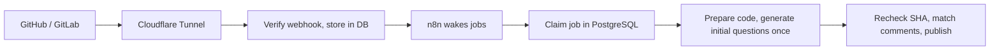

# CodeReviewBot

[](README.md)
[](README.en.md)

**A self-hosted question bot for GitHub pull requests and GitLab merge requests.**
Authors review code quality while writing code. The bot uses n8n and the Codex CLI or Claude Code CLI to read the change and related callers, ask Korean multiple-choice questions, and grade replies with explanations.
It no longer performs automatic code review, generates findings or reports CI results.

> [!NOTE]
> The bot never commits code, approves or merges. It only posts comments.
> Questions and bot replies are written in Korean.

## Contents

- [Features](#features)
- [How it works](#how-it-works)
- [Quick start](#quick-start)
- [Question comments](#question-comments)
- [Comment commands](#comment-commands)
- [Learning through comments](#learning-through-comments)
- [Repository policy](#repository-policy)
- [Safety](#safety)
- [Project layout](#project-layout)
- [Docs](#docs)

## Features

| Feature | Description |
|---|---|
| Automatic questions | Each push generates questions about changed code and related callers. The first run covers the whole PR/MR; subsequent runs cover the new changes. A new push prevents publishing the obsolete result. |
| One initial generation call | One `initial_questions` model call produces questions and private answer keys, with a 120,000ms call timeout. Code validates structure, duplicates and source locations. |
| Change understanding | Exactly three questions (two basic, one advanced), four choices A–D, with a `[심화]` tag on the advanced one. |
| Answer grading | Reply with question numbers and choices for grades, explanations and per-option notes. A bare option letter works in a single-question inline thread. |
| Deeper learning | Each request adds five deeper questions, excluding those already asked. |
| Command help | Ordinary question, follow-up and grading comments show one help entry point. `/reviewbot help` returns the complete four-column table of 14 commands. |
| Merge after answering | Optional commit status requires answers to the initial questions visible in the current summary before merging. |
| Repository context | Maintainer-approved repository rules inform questions and explanations. |

## How it works



1. A GitHub or GitLab webhook arrives; its signature is verified and the job is stored in the database.
2. n8n wakes the next job every 10 seconds and checks for missed changes and answer-completion status every minute. CI events do not regenerate questions.
3. The controller prepares a fixed source snapshot. The selected model (Codex or Claude) generates the initial questions in one isolated call. No readable text change means no model call and an explicit unavailable reason.
4. Code validates question structure, duplicates, diff locations and answer-key structure. The controller rechecks SHAs before publishing and regenerates against new code after a push.
5. The summary first shows `질문 생성 중` (generating questions), the commit and an estimated duration, then becomes the questions. Estimates use only question-generation history from the new version, with a two-minute unmeasured default. Historical review durations are excluded.

A new push to an open PR/MR creates a new progress comment and preserves earlier question comments. Only the new comment becomes the new result. The two basic questions and one advanced question remain; at least one asks about the change's purpose or design rationale supported by code, with the others checking behavior, flow or edge cases. The bot must not guess the author's personal intentions as a correct answer.

Incremental generation receives the actual diff since the last question revision and previous question text. The full PR/MR diff supplies publication coordinates. A partial or failed previous generation, changed base refs or policy, or a force-push breaking ancestry falls back to full scope. The bot does not replay every intermediate push.

| Service | Role |
|---|---|
| `controller` | Webhook auth, job queue, Git cache and snapshots, platform API calls and comment publishing |
| `runner` | Runs the Codex CLI or Claude Code CLI (chosen with `MODEL_PROVIDER`; account login or API key). Uses only read/search tools on a fixed snapshot; has no Git write access. |
| `postgres` | Reports, job state, webhook deduplication, question and answer history |
| `n8n` | Periodic dispatch and recovery calls. Question generation and learning logic live in the controller. |
| `tunnel` | Optional. Exposes only the webhook path through Cloudflare Tunnel. |

## Quick start

### Requirements

- Node.js 22+, npm, Git
- Docker or Colima (for integration tests and running the server)
- At least 8 GiB of free disk space for image builds (on Colima, inside the VM disk)

### 1. Test locally

```sh
npm ci --ignore-scripts
npm test                       # unit tests
node scripts/integration.mjs   # integration tests with a temporary PostgreSQL container
npm run demo                   # question, learning and help examples without model calls
```

`npm run demo` writes `demo-report.md` (questions), `demo-inline.md` (question thread), `demo-learning.md` (five deeper questions and a grade) and `demo-help.md` (all commands) to `.local/`.
These are fixtures. Actual answer quality and time saved against the former workflow still require live model evaluation.

### 2. Run the server

```sh
node scripts/setup.mjs                  # create internal tokens and DB password in .env (keeps existing values)
docker compose build controller runner
docker compose up -d
node scripts/bootstrap-n8n.mjs          # register n8n workflows
node scripts/smoke.mjs                  # check it works
```

| URL | Purpose |
|---|---|
| <http://localhost:5688> | n8n (set up the Owner account on first visit) |
| <http://localhost:18092/healthz> | Controller health check |

The internal API, database and runner are not exposed externally.
Repository connections are off by default. To connect real GitHub or GitLab repositories, follow the [connection guide](docs/connections.md) (Korean).

> [!WARNING]
> Use `docker compose stop` to stop the server.
> `docker compose down -v` deletes credentials, the database and n8n state.

## Question comments

The comment opens with one line on how to answer and one on how to reveal answers and explanations; each question is a `####` heading. Only advanced questions carry a `[심화]` tag. Source commit and answer progress sit below the questions; the state label appears only for partial or failed runs. The old summary, findings and checks/caveats sections, review verdict and CI report have been removed. The question heading has no section number.

```markdown
### CodeReviewBot 변경 이해 질문

답변 달기: `/reviewbot answer Q1 B` — 여러 개는 `/reviewbot answer Q1 B Q2 C`
정답·해설 한 번에 보기: `/reviewbot showanswer` — 답하지 않고 모든 질문의 정답과 보기별 해설 확인

#### Q1. pay의 재시도에 첫 요청의 멱등 키를 전달하는 이유는 무엇인가요?
    A. 재시도마다 새 승인을 만들기 위해
    B. 외부 승인 서비스가 동일 요청을 식별하도록 하기 위해
    C. 주문 저장을 생략하기 위해
    D. 모든 오류의 재시도를 금지하기 위해

#### Q2. 외부 승인이 성공하고 주문 저장이 실패한 뒤 같은 키로 재시도하면 무엇을 기대하나요?
    A. 새로운 결제 승인이 반드시 발생한다
    B. 주문 저장은 항상 생략한다
    C. 외부 승인이 자동 취소된다
    D. 같은 승인을 식별하고 주문 저장을 다시 시도한다

#### Q3. [심화] DB 트랜잭션만으로 외부 승인을 되돌릴 수 없는 이유는 무엇인가요?
    A. 외부 서비스의 부작용이 로컬 DB 트랜잭션에 참여하지 않기 때문에
    B. DB 트랜잭션은 읽기만 허용하기 때문에
    C. 멱등 키가 DB 잠금을 해제하기 때문에
    D. 주문 저장보다 승인이 항상 느리기 때문에

기준 커밋 bbbbbbbb · 답변 0/3
명령어 안내: `/reviewbot help`
```

In actual comments, the source commit is linked and each choice occupies its own line. The question list carries no code locations; grading and reveal replies link to the exact source revision. The payment behavior above is an illustrative fixture assumption.

Questions on publishable diff lines also receive an inline thread. Questions that cannot be positioned in the diff remain in the summary. New findings and code-fix suggestions are not published.

- Topics fit the change: behavior and invariants, design choices, edge cases, failure recovery and relevant technical principles.
- Each initial batch has exactly three questions, two basic and one advanced (always last, Q3), with one correct answer among A–D. The key and explanations stay private until grading or `/reviewbot showanswer`.
- Code validates question/key structure and source locations. There is no extra model verification pass to guarantee semantic correctness; live evaluation is still needed.
- Binary-only or excluded-only changes show why questions are unavailable. Failures and source limits are shown as generation state and a short reason.
- Comment compaction is disclosed and preserves at least three initial questions and all their choices.

### Transition from existing results

New results use `schemaVersion: "2"`. A previous result is converted once even when head/base/start SHAs are unchanged; subsequent runs reuse the question result. Old results awaiting publication are regenerated as questions and never repost historical findings.
The existing database, published questions and answer history are retained. Explicit explain/dismiss commands still handle historical findings. Previously published remote comments are kept.

## Comment commands

Control the bot with PR/MR comments. Requires Write (GitHub) or Developer (GitLab) access or higher.

Ordinary bot comments show only `명령어 안내: /reviewbot help`; the question summary also shows the answer and reveal lines. Help runs without a model and works even when no questions exist or generation is paused. Its four columns are command, meaning, description and example; all 14 commands are included.

| Command | Action |
|---|---|
| `/reviewbot help` | Show the complete command table |
| `/reviewbot review` | Regenerate questions for the latest change scope |
| `/reviewbot full` | Regenerate questions for the entire PR/MR |
| `/reviewbot pause` | Pause automatic question generation |
| `/reviewbot resume` | Resume automatic question generation |
| `/reviewbot explain` | Explain historical review findings: the current finding thread or all remaining findings from an ordinary comment; an explicit ID selects one |
| `/reviewbot dismiss reason` | Dismiss a historical finding in its thread; use `/reviewbot dismiss CRB-0001 reason` from an ordinary comment |
| `@reviewbot question` | Answer a question using code evidence |
| `/reviewbot morequestion` | Add five deeper questions |
| `/reviewbot answer Q1 B Q2 C` | Answer one or several questions by number and option, then receive grades and explanations |
| `/reviewbot showanswer` | Reveal answers and explanations for every review question without answering. Name questions (`/reviewbot showanswer Q1 심화2`) to reveal only those, follow-ups included |
| `/reviewbot learn rule` | Propose a repository rule |
| `/reviewbot approve UUID` | Approve a rule (maintainers) |
| `/reviewbot reject UUID` | Reject a rule (maintainers) |

Approving or rejecting rules requires GitHub Maintain/Admin or GitLab Maintainer or higher.
Ordinary conversation and dismissals never become rules automatically.

## Learning through comments

### Answering a question

Every question has four options. Answer with the question number (`Q1`) and an option letter (`A`–`D`), optionally followed by your reasoning.
Initial questions are numbered `Q1`, `Q2`…; questions from `/reviewbot morequestion` are numbered separately as `심화1`, `심화2`… so the two never collide. Follow-up numbers continue across requests within one code revision (심화1–5, then 심화6–10). Hash IDs like `Q-0123456789ab` from older comments still work.

```text
/reviewbot answer Q1 B
/reviewbot answer Q1 B Q2 C Q3 A
/reviewbot answer 심화1 B 심화2 C
```

- Each initial question is also posted as an inline thread on its code line; replying with just `B` there is graded.
- The answer key is fixed when the question is written and stays out of question comments until grading or `/reviewbot showanswer`. A bare option letter is graded from the key without a model call; added reasoning is assessed by the model, but the key alone decides right or wrong.
- After grading, the summary comment marks the question (`✅ 정답`, `🟡 부분 정답`, `❌ 오답`, `⏸ 판정 보류`) and updates `답변 n/m`.

The bot replies in this order:

**Correct · Partially correct · Incorrect · Undecided → Answer assessment → Explanation → Per-option notes → Code evidence**

Design questions accept any reasonable alternative. If the code evidence is not enough, the bot withholds a verdict.

### Reveal answers and explanations

Comment `/reviewbot showanswer` to get the answer, code location, explanation and per-option notes for every review question in one reply, without answering. Add numbers (`/reviewbot showanswer Q1 심화2`, up to 10) to reveal only those; follow-up questions appear only when named.

- It is built from the stored key, so no model is called.
- It is not grading, so it does not change `답변 n/m` or the `requireAnswers` merge gate.
- Older questions stored without a key point the reader to `/reviewbot answer` instead.

### Getting deeper questions

Comment `/reviewbot morequestion` to get five deeper questions, excluding ones already asked, in the same format as initial questions.
They cover how the technique works, design choices, failure recovery, concurrency, performance and test strategy.

- 5 questions at a time, up to 5 requests per code version across the whole PR/MR
- The model call timeout for initial generation (`initial_questions`), deeper questions (`questions`) and reasoning grades (`grade`) is 120,000ms each. Queueing, source preparation, publication and retries take additional time.

### Merge only after every question is answered (optional)

Add `requireAnswers: true` to `.codereviewbot.yaml` and the bot posts a `codereviewbot/questions` status on the PR's latest commit.
When a repository admin makes that status a required check, the merge button stays blocked until every initial question visible in the current summary is answered.

| Situation | Status |
|---|---|
| Some questions are unanswered | Pending · `질문 답변 1/3` (1 of 3 answered) |
| Every question shown in the report is answered (correct, incorrect or undecided all count) | Success |
| No questions could be made, e.g. only binary files changed | Success |
| Question generation failed | Pending · request again with `/reviewbot full` |

- An answer counts once its grading reply is posted. A wrong answer still counts, since it gets an explanation.
- Deeper questions from `/reviewbot morequestion` are not required.
- A new push starts over with the newly generated questions.
- See the [connection guide](docs/connections.md) (Korean) for setup.

<details>
<summary>Where replies go and how questions are kept</summary>

- In GitHub inline review threads and GitLab discussions, the bot replies in the same thread.
- For ordinary GitHub PR comments, the bot posts a new comment with a link to the request.
- In a bot thread with only one question, a plain reply is graded without an ID. With several, the bot asks for the ID.
- Comment bodies are read up to 8,000 characters.
- Questions are tied to the head, base and start SHAs. If the code changes, the bot points you to the latest questions.
- New revisions have separate question comments; earlier questions and grade marks remain unchanged. Publication retries and grade refreshes update only their revision's comment. Questions posted before the update are also preserved on new pushes, and existing questions for the current code can still be graded.
- Regenerating a report or failed question generation on the same code keeps posted question IDs and learning history.

</details>

## Repository policy

Put `.codereviewbot.yaml` on the target repository’s base branch to configure source scope and question context.

```yaml
version: 1
maxInlineComments: 5    # legacy finding limit; does not limit question threads
requireAnswers: false   # true: merge only after every question is answered
exclude: ["generated/**"]
pathInstructions:
  - path: "src/controllers/**"
    instructions: "인증·권한·입력 검증의 의도를 이해하는 질문을 출제한다."
```

- The policy is read from the base branch. Changing it in a PR does not change that PR's question policy.
- `AGENTS.md` and `docs/coding-standards.md` on the base branch, linked issues and approved repository rules are also used.
- Generated files, binaries, agent configs and credential files are excluded from question sources. An explicit reason is shown when no readable change remains.
- Limits: 1,500 files, 12 MiB total, 200 KB per file, 150 KB of diff. Anything beyond that marks question generation as partial.

## Safety

- The model CLI's built-in tools (shell, browser, other apps, sub-agents) are turned off; only read/search tools on a fixed snapshot are provided.
- The runner cannot reach the host home folder, the Docker socket or the Git cache. Only the controller has Git write credentials.
- The target project's code, tests and install scripts are never run.
- Instructions inside PR descriptions, issues and code comments are treated as data only.
- If a response is lost while publishing, the bot looks up existing comments and retries without duplicates.

## Project layout

```text
src/          controller and runner servers, question generation engine, platform adapters, renderer, DB store
migrations/   PostgreSQL schema
n8n/          n8n workflows (generated by scripts/generate-workflows.mjs)
config/       sample repository config (repositories.yaml is not committed)
ops/          DB init and Cloudflare Tunnel examples
scripts/      setup, n8n bootstrap, smoke and integration tests, demo
test/         unit tests and test/integration integration tests
docs/         implementation contract, progress log, connection and operations guides
```

## Docs

| Document | Contents |
|---|---|
| [Connection guide](docs/connections.md) | Question engine (Codex/Claude) login and API keys, GitHub and GitLab, Cloudflare Tunnel (Korean) |
| [Operations guide](docs/operations.md) | Health checks, recovery, backups (Korean) |
| [Implementation contract](docs/plan.md) | Scope, output contract, acceptance criteria |
| [Progress log](docs/progress.md) | Work history and verification results |

## License

[MIT](LICENSE)
