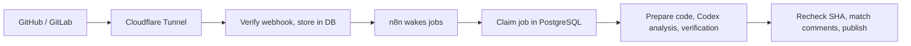

# CodeReviewBot

[](README.md)
[](README.en.md)

**A self-hosted bot that automatically reviews GitHub pull requests and GitLab merge requests.**
It runs on n8n and the Codex CLI, checks changes for bugs, security issues, regressions and team rules, and posts a Korean report and inline comments in a fixed format.
After each review it asks questions about the change; reply in a comment and it grades your answer and explains it.

> [!NOTE]
> The bot never commits code, approves or merges. It only posts comments.
> Review reports and bot replies are written in Korean.

## Contents

- [Features](#features)
- [How it works](#how-it-works)
- [Quick start](#quick-start)
- [Review report](#review-report)
- [Comment commands](#comment-commands)
- [Learning through comments](#learning-through-comments)
- [Repository policy](#repository-policy)
- [Safety](#safety)
- [Project layout](#project-layout)
- [Docs](#docs)

## Features

| Feature | Description |
|---|---|
| Automatic review | Batches pushes for 30 seconds, then reviews. The first run covers the whole change; later runs cover changed files and related code. |
| Second-pass verification | Every finding is verified again and checked against the real diff and code location before it is posted. |
| Fixed format | Reports always have the same four sections. The renderer, not the AI, decides the structure. |
| CI results | Reads GitHub Checks and commit statuses, and GitLab pipelines and failure logs. |
| Change questions | Each review includes 3–10 questions about the change, with code links. |
| Answer grading | Reply with a question ID to get a grade and explanation. Comment `더 알아보자` ("tell me more") for deeper questions. |
| Repository rules | Team rules can be proposed; only rules approved by a maintainer are used in later reviews. |

## How it works



1. A GitHub or GitLab webhook arrives; its signature is verified and the job is stored in the database.
2. n8n wakes the next job every 10 seconds and checks for missed changes and CI updates every minute.
3. The controller prepares a code snapshot, and Codex runs the analysis and verification in an isolated runner.
4. Right before publishing, the latest commit SHA is checked again. If a new push arrived, the result is dropped and the change is reviewed again.
5. A single summary comment is updated in place, and finding IDs are kept across reviews.

| Service | Role |
|---|---|
| `controller` | Webhook auth, job queue, Git cache and snapshots, platform API calls and comment publishing |
| `runner` | Runs the Codex CLI. Uses only read/search tools on a fixed snapshot; has no Git write access. |
| `postgres` | Reports, job state, webhook deduplication, question and answer history |
| `n8n` | Periodic dispatch and recovery calls. Review logic lives in the controller. |
| `tunnel` | Optional. Exposes only the webhook path through Cloudflare Tunnel. |

## Quick start

### Requirements

- Node.js 22+, npm, Git
- Docker or Colima (for integration tests and running the server)
- At least 8 GiB of free disk space for image builds (on Colima, inside the VM disk)

### 1. Test locally

```sh
npm ci --ignore-scripts
npm test                       # unit tests
node scripts/integration.mjs   # integration tests with a temporary PostgreSQL container
npm run demo                   # sample reports without calling a model
```

`npm run demo` writes a sample report, inline comment and learning thread to `.local/`.
Tests use controlled fixtures, so they do not measure real model quality.

### 2. Run the server

```sh
node scripts/setup.mjs                  # create internal tokens and DB password in .env (keeps existing values)
docker compose build controller runner
docker compose up -d
node scripts/bootstrap-n8n.mjs          # register n8n workflows
node scripts/smoke.mjs                  # check it works
```

| URL | Purpose |
|---|---|
| <http://localhost:5688> | n8n (set up the Owner account on first visit) |
| <http://localhost:18092/healthz> | Controller health check |

The internal API, database and runner are not exposed externally.
Repository connections are off by default. To connect real GitHub or GitLab repositories, follow the [connection guide](docs/connections.md) (Korean).

> [!WARNING]
> Use `docker compose stop` to stop the server.
> `docker compose down -v` deletes credentials, the database and n8n state.

## Review report

The top line shows the verdict, state, review mode and commit link. Four sections always follow in the same order.

| Section | Contents |
|---|---|
| 1. 변경 요약 (Summary) | Purpose and key behavior of the change |
| 2. 발견 사항 (Findings) | Table of ID, severity, status, description and location |
| 3. 검증·주의사항 (Checks & caveats) | CI results, recommended checks, review limits |
| 4. 변경 이해 질문 (Questions) | 3–10 questions about this change |

<details>
<summary>Show a sample report</summary>

```markdown
## CodeReviewBot 리뷰

**수정 필요** · 완료 · 전체 · bbbbbbbb

### 1. 변경 요약
결제 처리 변경

### 2. 발견 사항
| ID       | 심각도 | 상태      | 내용           | 위치          |
|----------|--------|-----------|----------------|---------------|
| CRB-0001 | P1     | 새로 발견 | 중복 결제 가능 | src/pay.ts:4  |

### 3. 검증·주의사항
- 로컬 테스트: 미실행
- CI: 확인된 실행 결과 없음

### 4. 변경 이해 질문
1. Q-8b4a5a63851e 이번 pay 재시도 변경에서 중복 승인을 막으려면 어떤 조건을 유지해야 하나요?
2. Q-58e45222f8cc charge 호출이 성공하고 주문 저장이 실패하면 재시도 결과는 어떻게 달라지나요?
3. Q-adadb09d5f52 이 결제 흐름에서 멱등 키와 트랜잭션은 각각 어떤 실패를 다루나요?

답변: /reviewbot answer Q-ID 내 답변 · 심화 질문: 더 알아보자
```

</details>

### Inline comments

Inline comments show severity, category and ID, then follow this order. A code suggestion is added only when there is one.

**Problem → Trigger condition → Impact → Evidence → Fix direction → Recommended check**

### Status labels

| Label | Meaning |
|---|---|
| `판단 보류` (undecided) | Partial review or failure; no conclusion |
| `미실행` (not run) | A check that was not run |
| `확인 불가` (unavailable) | Information could not be obtained |
| `건너뜀` · `중립` (skipped · neutral) | CI results, shown separately from passed |

<details>
<summary>How questions are generated</summary>

- Topics are chosen to fit the change: key behavior and invariants, design intent and trade-offs, failure and edge cases, or how a newly introduced technique works.
- No general-knowledge questions or filler duplicates. Answers and explanations are not included in the report.
- Questions also go through the second pass, which checks real diff locations and duplicates.
- Pure renames link to the moved source.
- If only binary or excluded files changed, the review is marked partial and says why no questions could be made.
- Failed reviews never get made-up questions.
- If a comment hits the platform length limit, the four sections stay, content is shortened and marked as such, and at least three questions remain.

</details>

## Comment commands

Control the bot with PR/MR comments. Requires Write (GitHub) or Developer (GitLab) access or higher.

| Command | Action |
|---|---|
| `/reviewbot review` | Review the latest change |
| `/reviewbot full` | Full re-review |
| `/reviewbot pause` · `resume` | Pause · resume automatic reviews |
| `/reviewbot explain CRB-0001` | Recheck and explain a finding |
| `/reviewbot dismiss CRB-0001 reason` | Dismiss a finding in this PR/MR, with a reason |
| `@reviewbot question` or reply to a bot finding | Answer using code evidence |
| `더 알아보자` · `/reviewbot questions` | Add 3–10 deeper questions |
| `/reviewbot answer Q-ID your answer` or `Q-ID: your answer` | Grade and explain an answer |
| `/reviewbot learn rule` | Propose a repository rule |
| `/reviewbot approve UUID` · `reject UUID` | Approve · reject a rule (maintainers) |

Approving or rejecting rules requires GitHub Maintain/Admin or GitLab Maintainer or higher.
Ordinary conversation and dismissals never become rules automatically.

## Learning through comments

### Answering a question

Reply using the `Q-...` ID shown before each question. For multiple choice, write the option letter such as `A`; otherwise write your explanation.

```text
/reviewbot answer Q-0123456789ab B
```

The bot replies in this order:

**Correct · Partially correct · Incorrect · Undecided → Answer assessment → Explanation → Per-option notes (multiple choice) → Code evidence**

Design questions accept any reasonable alternative. If the code evidence is not enough, the bot withholds a verdict.

### Getting deeper questions

Comment `더 알아보자` ("tell me more") to get deeper questions, excluding ones already asked.
They cover how the technique works, design choices, failure recovery, concurrency, performance and test strategy.

- 3–10 questions at a time, up to 5 requests per code version across the whole PR/MR
- Question generation and grading each take at most 2 minutes

<details>
<summary>Where replies go and how questions are kept</summary>

- In GitHub inline review threads and GitLab discussions, the bot replies in the same thread.
- For ordinary GitHub PR comments, the bot posts a new comment with a link to the request.
- In a bot thread with only one question, a plain reply is graded without an ID. With several, the bot asks for the ID.
- Comment bodies are read up to 8,000 characters.
- Questions are tied to the head, base and start SHAs. If the code changes, the bot points you to the latest questions.
- Regenerating a report or a failed review on the same code keeps posted question IDs and learning history.

</details>

## Repository policy

Put `.codereviewbot.yaml` on the target branch of the reviewed repository to adjust the review.

```yaml
version: 1
maxInlineComments: 5
exclude: ["generated/**"]
pathInstructions:
  - path: "src/controllers/**"
    instructions: "인증·권한·입력 검증을 확인한다."
```

- The policy is read from the base branch. Changing it in a PR does not change that PR's review.
- `AGENTS.md` and `docs/coding-standards.md` on the base branch, linked issues and approved repository rules are also used.
- Generated files, binaries, agent configs and credential files are excluded from review and listed in the report.
- Limits: 1,500 files, 12 MiB total, 200 KB per file, 150 KB of diff. Anything beyond that marks the review as partial.

## Safety

- Codex's shell, browser, other-app and sub-agent tools are turned off; only read/search tools on a fixed snapshot are provided.
- The runner cannot reach the host home folder, the Docker socket or the Git cache. Only the controller has Git write credentials.
- The reviewed project's code, tests and install scripts are never run.
- Instructions inside PR descriptions, issues and code comments are treated as data only.
- If a response is lost while publishing, the bot looks up existing comments and retries without duplicates.

## Project layout

```text
src/          controller and runner servers, review engine, platform adapters, renderer, DB store
migrations/   PostgreSQL schema
n8n/          n8n workflows (generated by scripts/generate-workflows.mjs)
config/       sample repository config (repositories.yaml is not committed)
ops/          DB init and Cloudflare Tunnel examples
scripts/      setup, n8n bootstrap, smoke and integration tests, demo
test/         unit tests and test/integration integration tests
docs/         implementation contract, progress log, connection and operations guides
```

## Docs

| Document | Contents |
|---|---|
| [Connection guide](docs/connections.md) | Codex login, GitHub and GitLab, Cloudflare Tunnel (Korean) |
| [Operations guide](docs/operations.md) | Health checks, recovery, backups (Korean) |
| [Implementation contract](docs/plan.md) | Scope, output contract, acceptance criteria |
| [Progress log](docs/progress.md) | Work history and verification results |

## License

[MIT](LICENSE)
