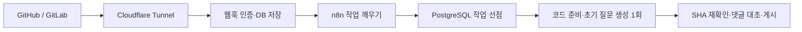

# CodeReviewBot

[](README.md)
[](README.en.md)

**GitHub PR과 GitLab MR의 변경 내용을 묻는 개인 서버용 질문봇입니다.**
코드 품질 검토는 작성자가 코드를 작성하면서 수행합니다. 봇은 n8n과 Codex CLI 또는 Claude Code CLI로 변경 코드와 관련 호출부를 읽고, 이해를 확인하는 한국어 객관식 질문을 냅니다. 댓글로 답하면 채점과 해설을 돌려줍니다.
자동 코드 리뷰·결함 탐색·CI 결과 보고는 수행하지 않습니다.

> [!NOTE]
> 봇은 코드를 커밋하거나 PR을 승인·머지하지 않습니다. 댓글만 남깁니다.

## 목차

- [주요 기능](#주요-기능)
- [동작 방식](#동작-방식)
- [빠른 시작](#빠른-시작)
- [질문 댓글](#질문-댓글)
- [댓글 명령](#댓글-명령)
- [댓글로 이어가는 학습](#댓글로-이어가는-학습)
- [저장소 정책](#저장소-정책)
- [안전 설계](#안전-설계)
- [프로젝트 구조](#프로젝트-구조)
- [문서](#문서)

## 주요 기능

| 기능 | 설명 |
|---|---|
| 자동 질문 생성 | 푸시마다 변경 코드와 관련 호출부를 읽어 질문을 만듭니다. 첫 실행은 PR/MR 전체, 이후에는 새로 바뀐 범위를 다룹니다. 새 푸시가 오면 이전 결과의 게시를 막습니다. |
| 한 번의 초기 출제 | `initial_questions` 모델 호출 1회로 질문과 비공개 정답키를 생성합니다. 호출 제한은 120,000ms이며, 형식·중복·코드 위치는 프로그램이 검사합니다. |
| 변경 이해 질문 | 질문 3~10개, 각 보기 A~D 4개와 코드 링크, `[기본]`·`[심화]` 구분을 제공합니다. |
| 답변 채점 | 번호와 보기로 답하면 채점·문제 해설·보기별 해설을 받습니다. 인라인 질문 스레드에는 보기 문자만 답해도 됩니다. |
| 심화 학습 | 요청마다 기존 질문을 제외한 심화 질문 5개를 더 냅니다. |
| 명령어 도움말 | 일반 질문·심화 질문·채점 댓글에는 도움말 진입점 한 줄만 표시합니다. `/reviewbot help`가 전체 14개 명령의 4열 표를 반환합니다. |
| 답변 후 머지 | 선택 사항. 최신 질문에 모두 답해야 머지할 수 있도록 커밋 상태를 남깁니다. |
| 저장소별 맥락 | 관리자가 승인한 저장소 규칙을 출제와 해설에 반영합니다. |

## 동작 방식



1. GitHub·GitLab 웹훅이 들어오면 서명을 확인하고 작업을 DB에 저장합니다.
2. n8n이 10초마다 다음 작업을 깨우고, 1분마다 놓친 변경과 답변 완료 상태를 확인합니다. CI 이벤트는 질문 재생성을 유발하지 않습니다.
3. 컨트롤러가 고정 코드 스냅샷을 준비하고, 격리된 실행기의 선택한 모델(Codex 또는 Claude)이 질문을 생성합니다. 초기 출제는 모델 호출 1회이며, 텍스트 근거가 없으면 모델을 부르지 않고 사유를 표시합니다.
4. 프로그램이 질문 구조·중복·diff 위치·정답키 구조를 검사하고 게시 직전에 SHA를 다시 확인합니다. 새 푸시가 있으면 최신 코드에서 다시 출제합니다.
5. 시작 댓글에는 `질문 생성 중`·기준 커밋·예상 시간을 표시하고, 완료되면 같은 댓글을 질문으로 바꿉니다. 예상 시간은 새 버전의 질문 생성 이력만 사용하며, 이력이 없으면 2분을 기본값으로 표시합니다. 과거 리뷰 시간은 사용하지 않습니다.

| 서비스 | 역할 |
|---|---|
| `controller` | 웹훅 인증, 작업 큐, Git 캐시·스냅샷 준비, 플랫폼 API 호출과 댓글 게시 |
| `runner` | Codex CLI 또는 Claude Code CLI 실행 (`MODEL_PROVIDER`로 선택, 계정 로그인 또는 API 키). 고정 스냅샷 읽기·검색 도구만 쓰며 Git 쓰기 권한이 없습니다. |
| `postgres` | 보고서, 작업 상태, 웹훅 중복 제거, 질문·답변 이력 |
| `n8n` | 주기적인 dispatch·recovery 호출. 질문 생성과 학습 로직은 컨트롤러에 있습니다. |
| `tunnel` | 선택 사항. Cloudflare Tunnel로 웹훅 경로만 외부에 노출합니다. |

## 빠른 시작

### 준비물

- Node.js 22 이상, npm, Git
- Docker 또는 Colima (통합 테스트와 서버 실행에 필요)
- 이미지 빌드용 디스크 여유 공간 8 GiB 이상 (Colima는 VM 디스크 기준)

### 1. 로컬에서 테스트하기

```sh
npm ci --ignore-scripts
npm test                       # 단위 테스트
node scripts/integration.mjs   # 임시 PostgreSQL 컨테이너로 통합 테스트
npm run demo                   # 모델 호출 없이 질문·학습·도움말 예시 생성
```

`npm run demo`는 `.local/`에 `demo-report.md`(질문 댓글), `demo-inline.md`(질문 스레드), `demo-learning.md`(심화 5개와 채점), `demo-help.md`(전체 도움말)를 만듭니다.
모두 fixture 예시입니다. 실제 모델의 정답 품질과 종전 대비 소요 시간 감소는 실연동 평가가 필요합니다.

### 2. 서버 실행하기

```sh
node scripts/setup.mjs                  # .env에 내부 토큰·DB 비밀번호 생성 (기존 값 유지)
docker compose build controller runner
docker compose up -d
node scripts/bootstrap-n8n.mjs          # n8n 워크플로 등록
node scripts/smoke.mjs                  # 동작 확인
```

| 주소 | 용도 |
|---|---|
| <http://localhost:5688> | n8n (처음이면 Owner 계정 설정) |
| <http://localhost:18092/healthz> | 컨트롤러 상태 확인 |

내부 API, DB, 실행기는 외부에 노출되지 않습니다.
저장소 연결은 기본적으로 꺼져 있습니다. 실제 GitHub·GitLab에 연결하려면 [연결 가이드](docs/connections.md)를 따르세요.

> [!WARNING]
> 서버를 멈출 때는 `docker compose stop`을 사용하세요.
> `docker compose down -v`는 인증 정보, DB, n8n 상태를 모두 지웁니다.

## 질문 댓글

댓글 맨 위에 답변 방법과 정답·해설 보기 방법을 한 줄씩 안내하고, 질문은 `####` 제목으로 표시합니다. `[심화]` 질문에만 난이도 표시가 붙습니다. 기준 커밋·답변 진행률은 질문 아래에 둡니다. 정상 완료면 상태 표시를 생략하고, 부분 완료·실패일 때만 보입니다. 종전의 `1. 변경 요약`, `2. 발견 사항`, `3. 검증·주의사항`, 리뷰 판정과 CI 보고는 없어집니다. `변경 이해 질문`에는 번호를 붙이지 않습니다.

<details>
<summary>질문 댓글 예시 보기</summary>

```markdown
### CodeReviewBot 변경 이해 질문

답변 달기: `/reviewbot answer Q1 B` — 여러 개는 `/reviewbot answer Q1 B Q2 C`
정답·해설 한 번에 보기: `/reviewbot showanswer` — 답하지 않고 모든 질문의 정답과 보기별 해설 확인

#### Q1. pay의 재시도에 첫 요청의 멱등 키를 전달하는 이유는 무엇인가요?
    A. 재시도마다 새 승인을 만들기 위해
    B. 외부 승인 서비스가 동일 요청을 식별하도록 하기 위해
    C. 주문 저장을 생략하기 위해
    D. 모든 오류의 재시도를 금지하기 위해

#### Q2. 외부 승인이 성공하고 주문 저장이 실패한 뒤 같은 키로 재시도하면 무엇을 기대하나요?
    A. 새로운 결제 승인이 반드시 발생한다
    B. 주문 저장은 항상 생략한다
    C. 외부 승인이 자동 취소된다
    D. 같은 승인을 식별하고 주문 저장을 다시 시도한다

#### Q3. [심화] DB 트랜잭션만으로 외부 승인을 되돌릴 수 없는 이유는 무엇인가요?
    A. 외부 서비스의 부작용이 로컬 DB 트랜잭션에 참여하지 않기 때문에
    B. DB 트랜잭션은 읽기만 허용하기 때문에
    C. 멱등 키가 DB 잠금을 해제하기 때문에
    D. 주문 저장보다 승인이 항상 느리기 때문에

기준 커밋 bbbbbbbb · 답변 0/3
명령어 안내: `/reviewbot help`
```

실제 댓글에서는 기준 커밋이 해당 커밋으로 연결되고, 보기 A~D가 별도 줄에 표시됩니다. 질문 목록에는 코드 위치를 붙이지 않고, 채점·정답 보기 답글에서 해당 커밋의 소스로 연결합니다. 위 결제 흐름은 출력 예시를 위한 가정입니다.

</details>

초기 질문은 게시 가능한 diff 줄마다 인라인 스레드로도 달립니다. diff에 위치를 잡을 수 없는 질문은 요약 댓글에서 확인합니다. 새 결함 지적이나 코드 수정 제안은 게시하지 않습니다.

- 핵심 동작·불변 조건, 설계 선택, 실패·경계 상황, 도입 기술 중 실제 변경에 맞는 주제를 고릅니다.
- 질문은 3~10개이며 A~D 중 정답이 하나입니다. 정답과 해설은 저장하고 출제 댓글에는 공개하지 않습니다. 채점하거나 `/reviewbot showanswer`를 요청하면 공개합니다.
- 질문·정답키의 형식과 코드 근거 위치는 프로그램이 검증합니다. 정답의 의미적 정확성을 보장하는 추가 모델 검토는 없으므로 실제 모델 평가가 필요합니다.
- 바이너리·제외 파일만 바뀌어 출제 근거가 없으면 사유를 표시합니다. 실행 실패와 자료 제한도 생성 상태로 알립니다.
- 댓글 길이를 줄일 때는 축약 사실을 표시하고 초기 질문 최소 3개와 보기를 유지합니다.

### 기존 결과에서 전환

새 결과는 `schemaVersion: "2"`로 구분합니다. 같은 head/base/start SHA의 이전 결과도 한 번 새 질문으로 전환한 뒤 재사용합니다. 게시 대기 중인 옛 결과는 질문으로 재생성하며, 예전 발견 사항을 다시 게시하지 않습니다.
기존 DB와 게시된 질문·답변 이력은 유지합니다. 과거 지적의 명시적 설명·기각 명령도 남습니다. 이미 원격 플랫폼에 게시된 과거 댓글은 삭제하지 않습니다.

## 댓글 명령

PR·MR 댓글로 봇을 조작합니다. 저장소 Write(GitHub) 또는 Developer(GitLab) 이상 권한이 필요합니다.

일반 봇 댓글에는 `명령어 안내: /reviewbot help`만 보입니다. 질문 요약 댓글에만 답변·정답 보기 안내가 추가로 보입니다. 도움말은 모델 호출 없이 동작하며, 아직 질문이 없거나 자동 생성이 일시정지된 PR/MR에서도 사용할 수 있습니다. 아래 14개 명령을 도움말의 `명령어·뜻·설명·사용 예시` 표로 확인할 수 있습니다.

| 명령 | 동작 |
|---|---|
| `/reviewbot help` | 전체 명령어 표 표시 |
| `/reviewbot review` | 최신 변경 범위의 질문 재생성 |
| `/reviewbot full` | PR/MR 전체 범위의 질문 재생성 |
| `/reviewbot pause` | 자동 질문 생성 일시정지 |
| `/reviewbot resume` | 자동 질문 생성 재개 |
| `/reviewbot explain` | 과거 리뷰의 지적 설명. 지적 스레드에서는 해당 지적, 일반 댓글에서는 남은 지적 전체. ID 지정 가능 |
| `/reviewbot dismiss 이유` | 과거 지적 스레드에서 기각. 일반 댓글은 `/reviewbot dismiss CRB-0001 이유` |
| `@reviewbot 질문` | 코드 근거를 확인해 답변 |
| `/reviewbot morequestion` | 심화 질문 5개 추가 |
| `/reviewbot answer Q1 B Q2 C` | 한 개 또는 여러 질문을 번호·보기로 답하고 채점·해설 받기 |
| `/reviewbot showanswer` | 답하지 않고 변경 이해 질문 전체의 정답·해설 보기. `/reviewbot showanswer Q1 심화2`처럼 번호를 지정하면 그 질문만 (심화 질문 포함) |
| `/reviewbot learn 규칙` | 저장소별 규칙 제안 |
| `/reviewbot approve UUID` | 규칙 승인 (관리자) |
| `/reviewbot reject UUID` | 규칙 거절 (관리자) |

`/reviewbot` 명령이나 `@reviewbot` 질문을 남기면 같은 스레드에 접수 안내가 바로 달립니다. 처리가 끝나 결과 답글이 달리면 안내는 지워지고, 재시도까지 모두 실패하면 실패 안내로 바뀝니다.
규칙 승인·거절은 GitHub Maintain/Admin 또는 GitLab Maintainer 이상만 할 수 있습니다.
일반 대화나 기각 내용이 자동으로 규칙이 되지는 않습니다.

## 댓글로 이어가는 학습

### 질문에 답하기

모든 질문은 4지선다입니다. 질문 번호와 보기 문자(`A`~`D`)로 답하고, 원하면 뒤에 이유를 덧붙입니다.
초기 질문은 `Q1`, `Q2`…, `/reviewbot morequestion`으로 받은 질문은 `심화1`, `심화2`…로 번호가 따로 붙어 헷갈리지 않습니다. 심화 번호는 같은 코드 버전 안에서 요청할 때마다 이어집니다(첫 요청 심화1~5, 다음 요청 심화6~10). 예전 댓글의 `Q-0123456789ab` 형식 ID도 그대로 쓸 수 있습니다.

```text
/reviewbot answer Q1 B
/reviewbot answer Q1 B Q2 C Q3 A
/reviewbot answer 심화1 B 심화2 C
/reviewbot answer Q1 B 첫 요청의 키를 재사용해야 승인 중복이 막힙니다
```

- 초기 질문은 코드 줄마다 인라인 스레드로도 달립니다. 그 스레드에는 `B`처럼 보기 문자만 답글로 달아도 채점합니다.
- 정답은 질문을 만들 때 함께 정해 저장하고 댓글에는 드러내지 않습니다. 보기 문자만 답하면 저장된 정답으로 바로 채점하고, 이유를 덧붙이면 모델이 이유까지 평가합니다. 맞고 틀림은 저장된 정답이 정합니다.
- 채점하면 요약 댓글의 질문 옆에 `✅ 정답` · `🟡 부분 정답` · `❌ 오답` · `⏸ 판정 보류`가 붙고 `답변 n/m`이 갱신됩니다.

봇은 다음 순서로 답합니다.

**채점 결과 → 내 답·정답 → 답변 평가(이유를 적었을 때) → 문제 해설 → 보기별 해설 → 코드 근거**

설계 문제는 타당한 대안도 인정합니다. 코드 근거가 부족하면 판정을 보류합니다.

### 정답·해설 바로 보기

`/reviewbot showanswer`를 남기면 답하지 않고 변경 이해 질문 전체의 정답, 코드 위치, 문제 해설, 보기별 해설을 답글 하나로 받습니다. `/reviewbot showanswer Q1 심화2`처럼 번호를 붙이면(최대 10개) 그 질문만 보여 줍니다. 심화 질문은 번호를 지정해야 표시됩니다.

- 저장된 정답으로 바로 만들므로 모델을 호출하지 않습니다.
- 채점이 아니므로 요약 댓글의 `답변 n/m`과 머지 조건(`requireAnswers`)에는 반영되지 않습니다.
- 정답을 저장하기 전에 만든 옛 질문은 `/reviewbot answer`로 채점받으라고 안내합니다.

### 심화 질문 받기

`/reviewbot morequestion`이라고 댓글을 남기면 이미 나온 질문을 빼고 더 깊은 질문 5개를 냅니다. 형식은 초기 질문과 같습니다.
기술 원리, 설계 선택, 실패 복구, 동시성, 성능, 테스트 전략 등을 다룹니다.

- 한 번에 5개, 같은 코드 버전에서 PR/MR 전체 기준 최대 5회
- 초기 출제(`initial_questions`), 심화 출제(`questions`), 이유 채점(`grade`)의 모델 호출 제한은 각각 120,000ms입니다. 큐 대기·코드 준비·댓글 게시·재시도 시간은 별도입니다.

### 모든 질문에 답한 뒤 머지하기 (선택)

`.codereviewbot.yaml`에 `requireAnswers: true`를 넣으면 봇이 PR의 최신 커밋에 `codereviewbot/questions` 상태를 남깁니다.
저장소 관리자가 이 상태를 필수 검사로 지정하면, 현재 요약 댓글에 표시된 초기 질문에 모두 답하기 전까지 머지 버튼이 막힙니다.

| 상황 | 상태 |
|---|---|
| 아직 답하지 않은 질문이 있음 | 대기 · `질문 답변 1/3` |
| 보고서에 보이는 질문에 모두 답함 (정답·오답·판정 보류 모두 인정) | 성공 |
| 바이너리만 바뀌는 등 질문을 만들 수 없음 | 성공 |
| 질문 생성 실패 | 대기 · `/reviewbot full`로 다시 요청 |

- 채점 댓글이 게시된 답변만 인정합니다. 오답이어도 해설을 받았으면 인정됩니다.
- `/reviewbot morequestion`으로 받은 심화 질문은 필수가 아닙니다.
- 새로 푸시하면 새로 생성한 질문을 기준으로 다시 셉니다.
- 설정 방법은 [연결 가이드](docs/connections.md#답변-완료-후-머지-선택)를 참고하세요.

<details>
<summary>답글 위치와 질문 보존 규칙</summary>

- GitHub 인라인 리뷰 스레드와 GitLab discussion에서는 같은 스레드에 답글을 답니다.
- 일반 GitHub PR 댓글에는 요청 댓글 링크를 넣은 새 댓글로 답합니다.
- 질문이 하나뿐인 봇 스레드에서는 번호 없이 보기 문자만 답해도 채점합니다. 여러 개면 번호를 지정하라고 안내합니다.
- 보기 문자로 시작하지 않는 답은 채점하지 않고 형식을 안내합니다.
- 댓글 본문은 최대 8,000자까지 읽습니다.
- 질문은 head·base·start SHA에 묶입니다. 코드가 바뀌면 최신 질문으로 답하라고 안내합니다.
- 같은 코드에서 보고서를 다시 만들거나 질문 생성이 실패해도 이미 게시한 질문 ID와 학습 이력은 남습니다.

</details>

## 저장소 정책

대상 저장소의 base 브랜치에 `.codereviewbot.yaml`을 두면 출제 범위와 맥락을 조정할 수 있습니다.

```yaml
version: 1
maxInlineComments: 5    # 과거 지적 댓글 제한 설정. 질문 스레드 수에는 적용하지 않음
requireAnswers: false   # true면 질문에 모두 답해야 머지 가능
exclude: ["generated/**"]
pathInstructions:
  - path: "src/controllers/**"
    instructions: "인증·권한·입력 검증의 의도를 이해하는 질문을 출제한다."
```

- 정책은 대상(base) 브랜치의 파일을 씁니다. PR에서 정책을 바꿔도 그 PR의 출제 정책은 바뀌지 않습니다.
- base의 `AGENTS.md`, `docs/coding-standards.md`, PR에 연결된 이슈, 승인된 저장소별 규칙도 참고합니다.
- 생성물, 바이너리, 에이전트 설정, 인증 파일은 출제 자료에서 제외합니다. 출제할 텍스트 근거가 없으면 이유를 표시합니다.
- 최대 1,500개 파일, 전체 12 MiB, 파일당 200 KB, diff 150 KB까지 읽습니다. 한도를 넘으면 일부 범위에서 출제한 것으로 표시합니다.

## 안전 설계

- 모델 CLI의 셸·브라우저·다른 앱·하위 에이전트 등 내장 도구를 끄고, 고정 스냅샷 읽기·검색 도구만 제공합니다.
- 실행기는 호스트 홈 폴더, Docker 소켓, Git 캐시에 접근하지 못합니다. Git 쓰기 권한은 컨트롤러에만 있습니다.
- 대상 프로젝트의 코드, 테스트, 설치 스크립트를 실행하지 않습니다.
- PR 설명, 이슈, 코드 주석 안의 지시문은 데이터로만 취급합니다.
- 댓글 게시 중 응답이 끊기면 기존 댓글을 조회해 중복 없이 다시 시도합니다.

## 프로젝트 구조

```text
src/          컨트롤러·실행기 서버, 질문 생성 엔진, 플랫폼 어댑터, 렌더러, DB 저장소
migrations/   PostgreSQL 스키마
n8n/          n8n 워크플로 (scripts/generate-workflows.mjs로 생성)
config/       저장소 연결 설정 예시 (repositories.yaml은 커밋하지 않음)
ops/          DB 초기화, Cloudflare Tunnel 설정 예시
scripts/      설정, n8n 등록, 스모크·통합 테스트, 데모
test/         단위 테스트, test/integration 통합 테스트
docs/         구현 계약, 작업 기록, 연결·운영 가이드
```

## 문서

| 문서 | 내용 |
|---|---|
| [연결 가이드](docs/connections.md) | 질문 생성 엔진(Codex·Claude) 로그인과 API 키, GitHub·GitLab, Cloudflare Tunnel 연결 |
| [운영 가이드](docs/operations.md) | 상태 확인, 장애 복구, 데이터 백업 |
| [구현 계약](docs/plan.md) | 범위, 출력 계약, 완료 기준 |
| [작업 기록](docs/progress.md) | 진행 내역과 검증 결과 |

## 라이선스

[MIT](LICENSE)
