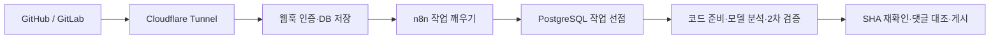

# CodeReviewBot

[](README.md)
[](README.en.md)

**GitHub PR과 GitLab MR을 자동으로 리뷰하는 개인 서버용 봇입니다.**
n8n과 Codex CLI 또는 Claude Code CLI로 동작하며, 버그·보안·회귀·팀 규칙을 검토해 항상 같은 양식의 한국어 보고서와 인라인 댓글을 남깁니다.
리뷰가 끝나면 변경 내용을 이해했는지 확인하는 질문을 내고, 댓글로 답하면 채점과 해설을 돌려줍니다.

> [!NOTE]
> 봇은 코드를 커밋하거나 PR을 승인·머지하지 않습니다. 댓글만 남깁니다.

## 목차

- [주요 기능](#주요-기능)
- [동작 방식](#동작-방식)
- [빠른 시작](#빠른-시작)
- [리뷰 보고서](#리뷰-보고서)
- [댓글 명령](#댓글-명령)
- [댓글로 이어가는 학습](#댓글로-이어가는-학습)
- [저장소 정책](#저장소-정책)
- [안전 설계](#안전-설계)
- [프로젝트 구조](#프로젝트-구조)
- [문서](#문서)

## 주요 기능

| 기능 | 설명 |
|---|---|
| 자동 리뷰 | 푸시마다 바로 리뷰합니다. 이전 리뷰가 끝나기 전에 새 푸시가 오면 최신 커밋으로 다시 리뷰합니다. 처음에는 전체를, 이후에는 바뀐 파일과 관련 코드를 검토합니다. |
| 2차 검증 | AI가 찾은 문제를 한 번 더 검증하고, 실제 diff와 코드 위치가 맞는지 확인한 뒤 게시합니다. |
| 고정 양식 | 보고서는 항상 같은 네 섹션으로 구성됩니다. 구조는 AI가 아니라 렌더러가 정합니다. |
| CI 결과 반영 | GitHub Checks·커밋 상태, GitLab pipeline과 실패 로그를 읽어 보고서에 포함합니다. |
| 변경 이해 질문 | 리뷰마다 이번 변경에 대한 질문 3~10개를 코드 링크와 함께 제공합니다. |
| 답변 채점 | `/reviewbot answer Q1 B`처럼 번호와 보기로 답하면 정답 여부와 해설을 돌려줍니다. `/reviewbot morequestion`으로 심화 질문 5개를 더 받을 수 있습니다. |
| 답변 후 머지 | 선택 사항. 질문에 모두 답해야 머지할 수 있도록 커밋 상태를 남깁니다. |
| 저장소별 학습 | 팀 규칙을 제안하고, 관리자가 승인한 규칙만 다음 리뷰에 반영합니다. |

## 동작 방식



1. GitHub·GitLab 웹훅이 들어오면 서명을 확인하고 작업을 DB에 저장합니다.
2. n8n이 10초마다 다음 작업을 깨우고, 1분마다 놓친 변경과 CI 갱신을 확인합니다.
3. 컨트롤러가 코드 스냅샷을 준비하고, 격리된 실행기에서 선택한 모델(Codex 또는 Claude)이 분석과 2차 검증을 합니다.
4. 게시 직전에 최신 커밋 SHA를 다시 확인합니다. 그 사이 새 푸시가 있으면 결과를 버리고 다시 리뷰합니다.
5. 리뷰를 시작하면 요약 댓글에 `리뷰 중`과 예상 소요 시간(최근 리뷰 시간의 중앙값)을 먼저 남기고, 끝나면 같은 댓글을 결과로 바꿉니다. 이전 결과는 그동안 접힌 채로 남습니다. 지적 ID는 다음 리뷰에서도 유지합니다.

| 서비스 | 역할 |
|---|---|
| `controller` | 웹훅 인증, 작업 큐, Git 캐시·스냅샷 준비, 플랫폼 API 호출과 댓글 게시 |
| `runner` | Codex CLI 또는 Claude Code CLI 실행 (`MODEL_PROVIDER`로 선택, 계정 로그인 또는 API 키). 고정 스냅샷 읽기·검색 도구만 쓰며 Git 쓰기 권한이 없습니다. |
| `postgres` | 보고서, 작업 상태, 웹훅 중복 제거, 질문·답변 이력 |
| `n8n` | 주기적인 dispatch·recovery 호출. 리뷰 로직은 컨트롤러에 있습니다. |
| `tunnel` | 선택 사항. Cloudflare Tunnel로 웹훅 경로만 외부에 노출합니다. |

## 빠른 시작

### 준비물

- Node.js 22 이상, npm, Git
- Docker 또는 Colima (통합 테스트와 서버 실행에 필요)
- 이미지 빌드용 디스크 여유 공간 8 GiB 이상 (Colima는 VM 디스크 기준)

### 1. 로컬에서 테스트하기

```sh
npm ci --ignore-scripts
npm test                       # 단위 테스트
node scripts/integration.mjs   # 임시 PostgreSQL 컨테이너로 통합 테스트
npm run demo                   # 모델 호출 없이 예시 보고서 생성
```

`npm run demo`는 `.local/` 폴더에 예시 보고서, 인라인 댓글, 학습 댓글을 만듭니다.
테스트는 통제된 fixture를 사용하므로 실제 모델 품질을 평가하지는 않습니다.

### 2. 서버 실행하기

```sh
node scripts/setup.mjs                  # .env에 내부 토큰·DB 비밀번호 생성 (기존 값 유지)
docker compose build controller runner
docker compose up -d
node scripts/bootstrap-n8n.mjs          # n8n 워크플로 등록
node scripts/smoke.mjs                  # 동작 확인
```

| 주소 | 용도 |
|---|---|
| <http://localhost:5688> | n8n (처음이면 Owner 계정 설정) |
| <http://localhost:18092/healthz> | 컨트롤러 상태 확인 |

내부 API, DB, 실행기는 외부에 노출되지 않습니다.
저장소 연결은 기본적으로 꺼져 있습니다. 실제 GitHub·GitLab에 연결하려면 [연결 가이드](docs/connections.md)를 따르세요.

> [!WARNING]
> 서버를 멈출 때는 `docker compose stop`을 사용하세요.
> `docker compose down -v`는 인증 정보, DB, n8n 상태를 모두 지웁니다.

## 리뷰 보고서

보고서 맨 위에는 결과·상태·검토 방식·커밋 링크가 한 줄로 표시되고, 그 아래 네 섹션이 항상 같은 순서로 나옵니다.

| 섹션 | 내용 |
|---|---|
| 1. 변경 요약 | 변경의 목적과 핵심 동작 |
| 2. 발견 사항 | ID·심각도·상태·내용·위치 표 |
| 3. 검증·주의사항 | CI 결과, 권장 확인, 검토 한계 |
| 4. 변경 이해 질문 | 이번 변경에 대한 4지선다 질문 3~10개 (Q1, Q2 …), `[기본]`·`[심화]` 표시, 답한 질문의 채점 결과 |
| 명령어 | 명령어·뜻·설명·사용 예시 표 |

<details>
<summary>보고서 예시 보기</summary>

```markdown
### CodeReviewBot 리뷰

**수정 필요** · 완료 · 전체 · bbbbbbbb

### 1. 변경 요약
결제 처리 변경

### 2. 발견 사항
| ID       | 심각도 | 상태      | 내용           | 위치          |
|----------|--------|-----------|----------------|---------------|
| CRB-0001 | 높음   | 새로 발견 | 중복 결제 가능 | src/pay.ts:4  |

### 3. 검증·주의사항
- 로컬 테스트: 미실행
- CI: 확인된 실행 결과 없음

### 4. 변경 이해 질문

보기 하나를 골라 `/reviewbot answer Q1 B`로 답하세요. 여러 개는 `/reviewbot answer Q1 B Q2 C` · 답변 1/3

**Q1. [기본] 이번 pay 재시도 변경에서 중복 승인을 막으려면 어떤 조건을 유지해야 하나요?** — src/pay.ts:2 · ✅ 정답\
&nbsp;&nbsp;&nbsp;&nbsp;**A.** 재시도마다 새 멱등 키를 만든다\
&nbsp;&nbsp;&nbsp;&nbsp;**B.** 첫 요청의 멱등 키를 재시도에 그대로 전달한다\
&nbsp;&nbsp;&nbsp;&nbsp;**C.** 승인 응답을 받기 전에 주문을 저장한다\
&nbsp;&nbsp;&nbsp;&nbsp;**D.** 재시도 간격을 늘려 동시 요청을 피한다

**Q2. [심화] charge 호출이 성공하고 주문 저장이 실패하면 재시도 결과는 어떻게 달라지나요?** — src/pay.ts:2\
&nbsp;&nbsp;&nbsp;&nbsp;**A.** ...

#### 명령어

| 명령어 | 뜻 | 설명 | 사용 예시 |
|---|---|---|---|
| `/reviewbot answer` | 답변 | 질문 번호와 보기(A~D)로 답하면 채점·해설, 여러 개를 한 번에 답할 수 있음 | `/reviewbot answer Q1 B Q2 C` |
| `/reviewbot morequestion` | 심화 질문 | 이미 나온 질문을 빼고 더 깊은 질문 5개 | `/reviewbot morequestion` |
| ... | | | |
```

</details>

### 인라인 댓글

심각도는 `치명`·`높음`·`보통`·`낮음`으로 표시합니다. 인라인 댓글은 심각도·분류·ID와 함께 다음 순서로 작성됩니다. 코드 제안은 있을 때만 붙습니다.

**문제 → 발생 조건 → 영향 → 근거 → 수정 방향 → 추천 검증**

### 상태 표기

| 표기 | 의미 |
|---|---|
| `판단 보류` | 부분 검토 또는 실패로 결론을 내리지 못함 |
| `미실행` | 실행하지 않은 검사 |
| `확인 불가` | 정보를 확보하지 못함 |
| `건너뜀` · `중립` | CI 결과. 통과와 구분해 표시 |

<details>
<summary>질문 생성 규칙 자세히 보기</summary>

- 핵심 동작·불변 조건, 설계 의도·트레이드오프, 실패·경계 상황, 도입한 기술의 원리 중 변경에 맞는 주제를 고릅니다.
- 일반 상식 질문이나 수를 채우기 위한 중복 질문은 넣지 않습니다. 답과 해설은 보고서에 넣지 않습니다.
- 질문도 2차 검토를 거치며, 실제 diff 위치와 중복 여부를 검사합니다.
- 이름만 바뀐 파일은 이동한 소스에 연결합니다.
- 바이너리나 제외 파일만 바뀐 경우 부분 검토로 표시하고, 질문을 만들 수 없는 이유를 밝힙니다.
- 실패한 리뷰에는 질문을 꾸며 넣지 않습니다.
- 댓글 길이 제한에 걸리면 네 섹션을 유지한 채 내용을 줄이고, 줄였다는 사실을 표시합니다. 질문은 최소 3개를 유지합니다.

</details>

## 댓글 명령

PR·MR 댓글로 봇을 조작합니다. 저장소 Write(GitHub) 또는 Developer(GitLab) 이상 권한이 필요합니다.

| 명령 | 동작 |
|---|---|
| `/reviewbot review` | 최신 변경 검토 |
| `/reviewbot full` | 전체 다시 검토 |
| `/reviewbot pause` · `resume` | 자동 리뷰 일시정지 · 재개 |
| `/reviewbot explain` | 지적을 다시 확인하고 설명. 지적 댓글에 답글로 쓰면 그 지적, 일반 댓글이면 남은 지적 전체. `CRB-0001`처럼 ID를 붙여 하나만 고를 수도 있음 |
| `/reviewbot dismiss 이유` | 지적 댓글에 답글로 쓰면 사유를 남기고 이 PR/MR에서 기각. 일반 댓글에서는 `/reviewbot dismiss CRB-0001 이유` |
| `@reviewbot 질문` 또는 봇 지적에 답글 | 코드 근거를 확인해 답변 |
| `/reviewbot morequestion` | 심화 질문 5개 추가 |
| `/reviewbot answer Q1 B` · `/reviewbot answer Q1 B Q2 C` | 질문 번호와 보기로 답하면 채점과 해설, 여러 개를 한 번에 |
| `/reviewbot learn 규칙` | 저장소별 규칙 제안 |
| `/reviewbot approve UUID` · `reject UUID` | 규칙 승인 · 거절 (관리자) |

규칙 승인·거절은 GitHub Maintain/Admin 또는 GitLab Maintainer 이상만 할 수 있습니다.
일반 대화나 기각 내용이 자동으로 규칙이 되지는 않습니다.

## 댓글로 이어가는 학습

### 질문에 답하기

모든 질문은 4지선다입니다. 질문 번호와 보기 문자(`A`~`D`)로 답하고, 원하면 뒤에 이유를 덧붙입니다.
리뷰 질문은 `Q1`, `Q2`…, `/reviewbot morequestion`으로 받은 질문은 `심화1`, `심화2`…로 번호가 따로 붙어 헷갈리지 않습니다. 심화 번호는 같은 코드 버전 안에서 요청할 때마다 이어집니다(첫 요청 심화1~5, 다음 요청 심화6~10). 예전 댓글의 `Q-0123456789ab` 형식 ID도 그대로 쓸 수 있습니다.

```text
/reviewbot answer Q1 B
/reviewbot answer Q1 B Q2 C Q3 A
/reviewbot answer 심화1 B 심화2 C
/reviewbot answer Q1 B 첫 요청의 키를 재사용해야 승인 중복이 막힙니다
```

- 리뷰 질문은 코드 줄마다 인라인 스레드로도 달립니다. 그 스레드에는 `B`처럼 보기 문자만 답글로 달아도 채점합니다.
- 정답은 질문을 만들 때 함께 정해 저장하고 댓글에는 드러내지 않습니다. 보기 문자만 답하면 저장된 정답으로 바로 채점하고, 이유를 덧붙이면 모델이 이유까지 평가합니다. 맞고 틀림은 저장된 정답이 정합니다.
- 채점하면 요약 댓글의 질문 옆에 `✅ 정답` · `🟡 부분 정답` · `❌ 오답` · `⏸ 판정 보류`가 붙고 `답변 n/m`이 갱신됩니다.

봇은 다음 순서로 답합니다.

**채점 결과 → 내 답·정답 → 답변 평가(이유를 적었을 때) → 문제 해설 → 보기별 해설 → 코드 근거**

설계 문제는 타당한 대안도 인정합니다. 코드 근거가 부족하면 판정을 보류합니다.

### 심화 질문 받기

`/reviewbot morequestion`이라고 댓글을 남기면 이미 나온 질문을 빼고 더 깊은 질문 5개를 냅니다. 형식은 리뷰 질문과 같습니다.
기술 원리, 설계 선택, 실패 복구, 동시성, 성능, 테스트 전략 등을 다룹니다.

- 한 번에 5개, 같은 코드 버전에서 PR/MR 전체 기준 최대 5회
- 질문 생성과 채점은 각각 최대 2분

### 모든 질문에 답한 뒤 머지하기 (선택)

`.codereviewbot.yaml`에 `requireAnswers: true`를 넣으면 봇이 PR의 최신 커밋에 `codereviewbot/questions` 상태를 남깁니다.
저장소 관리자가 이 상태를 필수 검사로 지정하면, 리뷰 질문에 모두 답하기 전까지 머지 버튼이 막힙니다.

| 상황 | 상태 |
|---|---|
| 아직 답하지 않은 질문이 있음 | 대기 · `질문 답변 1/3` |
| 보고서에 보이는 질문에 모두 답함 (정답·오답·판정 보류 모두 인정) | 성공 |
| 바이너리만 바뀌는 등 질문을 만들 수 없음 | 성공 |
| 리뷰 실패 | 대기 · `/reviewbot full`로 다시 요청 |

- 채점 댓글이 게시된 답변만 인정합니다. 오답이어도 해설을 받았으면 인정됩니다.
- `/reviewbot morequestion`으로 받은 심화 질문은 필수가 아닙니다.
- 새로 푸시하면 새 리뷰의 질문을 기준으로 다시 셉니다.
- 설정 방법은 [연결 가이드](docs/connections.md#답변-완료-후-머지-선택)를 참고하세요.

<details>
<summary>답글 위치와 질문 보존 규칙</summary>

- GitHub 인라인 리뷰 스레드와 GitLab discussion에서는 같은 스레드에 답글을 답니다.
- 일반 GitHub PR 댓글에는 요청 댓글 링크를 넣은 새 댓글로 답합니다.
- 질문이 하나뿐인 봇 스레드에서는 번호 없이 보기 문자만 답해도 채점합니다. 여러 개면 번호를 지정하라고 안내합니다.
- 보기 문자로 시작하지 않는 답은 채점하지 않고 형식을 안내합니다.
- 댓글 본문은 최대 8,000자까지 읽습니다.
- 질문은 head·base·start SHA에 묶입니다. 코드가 바뀌면 최신 질문으로 답하라고 안내합니다.
- 같은 코드에서 보고서를 다시 만들거나 리뷰가 실패해도 이미 게시한 질문 ID와 학습 이력은 남습니다.

</details>

## 저장소 정책

리뷰할 저장소의 대상 브랜치에 `.codereviewbot.yaml`을 두면 리뷰 기준을 조정할 수 있습니다.

```yaml
version: 1
maxInlineComments: 5
requireAnswers: false   # true면 질문에 모두 답해야 머지 가능
exclude: ["generated/**"]
pathInstructions:
  - path: "src/controllers/**"
    instructions: "인증·권한·입력 검증을 확인한다."
```

- 정책은 대상(base) 브랜치의 파일을 씁니다. PR에서 정책을 바꿔도 그 PR의 리뷰 기준은 바뀌지 않습니다.
- base의 `AGENTS.md`, `docs/coding-standards.md`, PR에 연결된 이슈, 승인된 저장소별 규칙도 참고합니다.
- 생성물, 바이너리, 에이전트 설정, 인증 파일은 검토에서 제외하고 보고서에 표시합니다.
- 최대 1,500개 파일, 전체 12 MiB, 파일당 200 KB, diff 150 KB까지 읽습니다. 한도를 넘으면 부분 검토로 표시합니다.

## 안전 설계

- 모델 CLI의 셸·브라우저·다른 앱·하위 에이전트 등 내장 도구를 끄고, 고정 스냅샷 읽기·검색 도구만 제공합니다.
- 실행기는 호스트 홈 폴더, Docker 소켓, Git 캐시에 접근하지 못합니다. Git 쓰기 권한은 컨트롤러에만 있습니다.
- 리뷰 대상 프로젝트의 코드, 테스트, 설치 스크립트를 실행하지 않습니다.
- PR 설명, 이슈, 코드 주석 안의 지시문은 데이터로만 취급합니다.
- 댓글 게시 중 응답이 끊기면 기존 댓글을 조회해 중복 없이 다시 시도합니다.

## 프로젝트 구조

```text
src/          컨트롤러·실행기 서버, 리뷰 엔진, 플랫폼 어댑터, 렌더러, DB 저장소
migrations/   PostgreSQL 스키마
n8n/          n8n 워크플로 (scripts/generate-workflows.mjs로 생성)
config/       저장소 연결 설정 예시 (repositories.yaml은 커밋하지 않음)
ops/          DB 초기화, Cloudflare Tunnel 설정 예시
scripts/      설정, n8n 등록, 스모크·통합 테스트, 데모
test/         단위 테스트, test/integration 통합 테스트
docs/         구현 계약, 작업 기록, 연결·운영 가이드
```

## 문서

| 문서 | 내용 |
|---|---|
| [연결 가이드](docs/connections.md) | 리뷰 엔진(Codex·Claude) 로그인과 API 키, GitHub·GitLab, Cloudflare Tunnel 연결 |
| [운영 가이드](docs/operations.md) | 상태 확인, 장애 복구, 데이터 백업 |
| [구현 계약](docs/plan.md) | 범위, 출력 계약, 완료 기준 |
| [작업 기록](docs/progress.md) | 진행 내역과 검증 결과 |

## 라이선스

[MIT](LICENSE)
