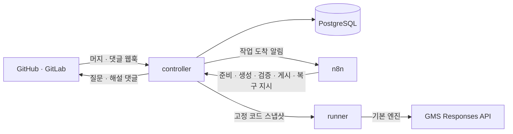

# hey

### hey! 이건 알고 머지한거지? 😏

**머지한 코드에서 배울 CS 지식을 질문과 해설로 남기는 GitHub·GitLab 학습 봇.**

PR/MR이 머지되면 최종 변경을 읽고 기본 수준의 객관식 질문 **2개**를 댓글로 남깁니다. 답을 고르면 코드 근거와 CS 원리를 함께 설명하고, 더 공부하고 싶을 때 추가 질문 **5개**를 요청할 수 있습니다.

[English](README.en.md) · [시작하기](#시작하기) · [댓글 명령](#댓글-명령) · [설치와 연결](#설치와-연결) · [운영 가이드](docs/operations.md)

## 이렇게 사용합니다

1. **PR/MR을 머지합니다.** 열기·재열기·푸시에는 자동 질문을 만들지 않습니다.
2. **질문 2개를 풉니다.** 실제 변경에 필요한 CS 개념을 A~D 보기로 확인합니다. 최초 질문에 심화 문제를 섞지 않습니다.
3. **해설로 원리를 확인합니다.** 정답 보기의 문장, 해설, 보기별 설명과 해당 커밋의 코드 근거를 받습니다.
4. **필요하면 더 풀어봅니다.** `/hey whatelse`로 같은 변경을 한 단계 깊게 다루는 질문 5개를 받습니다.

질문과 답변은 한국어로 작성합니다. hey는 코드 이해를 위한 봇이며, 자동 결함 탐색·코드 수정·PR 승인·머지를 수행하지 않습니다.

### 질문은 이런 모습입니다

아래는 결제 재시도에 같은 멱등 키를 전달하는 코드를 가정한 **질문 한 개의 예시**입니다. 실제 최초 댓글에는 두 문제가 표시됩니다.

> #### hey! 이건 알고 머지한거지? 😏
>
> #### Q1. 결제 재시도에 첫 요청의 멱등 키를 사용하는 이유는 무엇인가요?
>
> A. 재시도마다 새 승인을 만들기 위해서입니다.<br>
> B. 동일 요청을 식별해 중복 승인을 막기 위해서입니다.<br>
> C. 주문 저장을 생략하기 위해서입니다.<br>
> D. 모든 재시도를 금지하기 위해서입니다.
>
> ---
>
> 답변 달기: `/hey answer Q1 B`<br>
> 정답·해설 보기: 이 질문 스레드에 답글로 `/hey showanswer`<br>
> 더 풀어보기: `/hey whatelse`

질문은 H4 제목으로 구분하고 문제 뒤에 빈 줄을 둡니다. 기준 커밋은 해시 대신 **커밋 제목을 링크한 목록**으로 표시합니다. 추가 질문은 별도의 묶음 제목이나 `[심화]` 태그 없이 첫 문제부터 시작합니다.

해설은 정답 보기의 문장을 먼저 보여 주고, **해설 → 보기별 해설 → 코드 근거** 순서로 이어집니다. 보기별 설명은 보기 다음 줄에 들여쓰며, 각 설명은 CS 원리와 코드의 조건을 연결하는 1~3문장으로 생성합니다. 내 답과 정답의 보기 문자를 나란히 표시하지 않습니다.

[최초 질문 예시](docs/examples/initial-questions.md) · [추가 질문·해설 예시](docs/examples/whatelse-with-cs.md)

## 댓글 명령

연결된 PR/MR에 댓글을 남기면 됩니다. 명령 사용자는 GitHub Write 또는 GitLab Developer 이상 권한이 필요합니다. 닫히거나 머지된 PR/MR에서도 명령을 사용할 수 있습니다.

| 하고 싶은 일 | 댓글 |
|---|---|
| 도움말 보기 | `/hey help` |
| 한 문제 답하기 | `/hey answer Q1 B` |
| 여러 문제 답하기 | `/hey answer Q1 B Q2 A` |
| 답글을 남긴 질문 댓글의 정답·해설 보기 | `/hey showanswer` |
| 추가 질문 5개 받기 | `/hey whatelse` |
| CS 면접 대비 질문 최대 5개 받기 | `/hey csinterview` |
| 질문 다시 만들기 | `/hey tryagain` |
| 코드에 관해 질문하기 | `@hey 이 변경에서 멱등성이 필요한 이유가 뭔가요?` |

### 답변과 해설

- 답 뒤에 이유를 덧붙일 수 있습니다. 예: `/hey answer Q1 B 같은 요청의 승인을 재사용해야 하기 때문입니다`.
- 질문 하나가 있는 인라인 스레드에는 `B`처럼 보기 문자만 답해도 채점합니다. 요약 댓글에서는 질문 번호를 사용하세요.
- 보기만 고르면 저장된 정답으로 채점합니다. 이유를 쓰면 모델이 그 이유도 평가합니다.
- `/hey showanswer`는 저장된 해설을 보여 주며 모델을 호출하거나 답변 완료로 처리하지 않습니다.
- **해설 범위는 답글을 남긴 질문 댓글로 정합니다.** 최초 질문 댓글 아래에서 호출하면 최초 질문만, 추가 질문 댓글 아래에서 호출하면 그 묶음만 공개합니다. 개별 번호를 붙이는 형식은 지원하지 않습니다.
- 추가 질문은 묶음마다 새 스레드에 게시합니다. 질문 스레드 밖에서 호출하면 해당 질문 댓글에 답글을 남기도록 안내합니다. 이전 코드 버전이나 여러 질문 묶음이 섞인 옛 스레드에서는 임의로 해설을 선택하지 않습니다.
- GitLab에서는 질문 댓글의 답글을 사용하세요. GitHub의 일반 PR 댓글에는 하위 답글이 없으므로 **코드에 달린 질문 스레드**를 사용합니다. 추가 질문 5개는 별도 코드 스레드에 함께 게시하며, 최초 인라인 스레드에서는 그 스레드에 표시된 한 문제만 해설합니다.

추가 질문 번호는 같은 코드 버전에서 `심화1~5`, `심화6~10`처럼 이어집니다. PR/MR 전체에서 코드 버전당 최대 5회 요청할 수 있습니다. 이전 코드 버전의 질문·답변 이력은 보존합니다.

### CS 기술 면접 대비

`/hey csinterview`는 실제 변경에서 CS 주제를 찾아, 다른 상황에도 적용할 수 있는 원리·성립 조건·유사 개념의 차이를 4지선다로 묻습니다. 문제에 필요한 조건을 포함하므로 저장소의 함수명이나 상수를 외우지 않아도 풀 수 있습니다. CS 용어는 정확한 한국어 명칭과 필요한 영어 원어·약어를 사용하고, 해설에서 뜻과 적용 범위를 설명합니다.

- 한 번에 최대 5문항을 생성합니다. 근거가 부족하면 적게 출제하거나 출제하지 않고 사유를 안내합니다. 최초 질문 생성 전에도 사용할 수 있습니다.
- `면접1`, `면접2`처럼 별도로 번호를 붙입니다. 예: `/hey answer 면접1 B 면접2 C`. 답변에 이유를 덧붙이면 용어·개념의 혼동도 피드백하며, 동의어나 한국어·영어 표현 차이만으로 감점하지 않습니다.
- 해당 면접 질문 스레드에 `/hey showanswer`로 답글을 남기면 그 묶음의 저장된 정답·해설을 확인합니다. 기존과 같이 모델을 호출하거나 답변 완료로 처리하지 않습니다.
- 번호와 생성 한도는 심화 질문과 별도입니다. 같은 코드 버전에서 번호가 이어지며, PR/MR 전체에서 면접 질문 묶음을 최대 5회 생성할 수 있습니다. 면접 질문은 머지 전 답변 완료 조건에 추가되지 않습니다.

[면접 질문·해설 예시](docs/examples/csinterview.md)는 모델을 호출하지 않는 고정 예시입니다. 출제 지침과 구조 검증이 질문·정답의 의미적 정확성까지 보장하지는 않습니다.

## 시작하기

**Node.js 22 이상, npm, Git**이 필요합니다. 서버와 통합 테스트에는 **Docker Compose 또는 Docker Compose를 사용할 수 있는 Colima**가 필요합니다.

먼저 API 키나 외부 계정 없이 댓글 예시를 만들어 볼 수 있습니다.

```sh
git clone https://github.com/thisis-joe/codereviewbot.git
cd codereviewbot
npm ci --ignore-scripts
npm run demo
```

다음 파일을 열어 질문·해설 형식을 확인하세요. 데모는 고정 예시를 사용하며 모델을 호출하지 않습니다.

| 생성 파일 | 내용 |
|---|---|
| `.local/demo-report.md` | 최초 질문 댓글 |
| `.local/demo-inline.md` | 코드 줄에 달리는 질문 |
| `.local/demo-learning.md` | 추가 질문 5개와 채점·해설 |
| `.local/demo-csinterview.md` | CS 면접 질문과 스레드 정답·해설 |
| `.local/demo-help.md` | 전체 명령 도움말 |

## 설치와 연결

### 1. 로컬 설정 준비

```sh
node scripts/setup.mjs
```

내부 인증 값과 DB 비밀번호가 담긴 `.env`, 연결 대상 목록인 `config/repositories.yaml`을 준비합니다. 기존 값은 유지하며 외부 저장소 연결은 기본적으로 꺼져 있습니다.

`.env`에 발급받은 GMS 키를 넣으세요.

```dotenv
MODEL_PROVIDER=gms
GMS_KEY=<발급받은 키>
GMS_MODEL=gpt-6.1-sol
GMS_RESPONSES_URL=https://gms.ssafy.io/gmsapi/api.openai.com/v1/responses
```

기본 엔진은 **GMS Responses API 직접 호출**입니다. `MODEL_PROVIDER=gms`일 때 Claude CLI를 호출하지 않으며, 오류가 나도 다른 엔진으로 자동 전환하지 않습니다. `GMS_KEY`가 없으면 실행기가 시작하지 않습니다. 선택적으로 Codex CLI·Claude Code CLI를 사용할 수 있으며, 인증 방법은 [연결 가이드](docs/connections.md)에 있습니다.

### 2. 서비스 실행

```sh
docker compose build controller runner
docker compose up -d
```

[http://localhost:5688](http://localhost:5688)에서 n8n의 최초 Owner 계정을 설정한 뒤 워크플로를 등록하고 확인합니다.

```sh
node scripts/bootstrap-n8n.mjs
node scripts/smoke.mjs
```

컨트롤러 상태는 [http://localhost:18092/healthz](http://localhost:18092/healthz)에서 확인합니다. 스모크 검사는 상태 확인, 내부 인증, n8n에서 컨트롤러로의 호출을 검사하며 실제 모델·GitHub·GitLab 연결까지 검증하지는 않습니다.

### 3. GitHub·GitLab 연결

[연결 가이드](docs/connections.md)에 따라 봇 인증, `config/repositories.yaml`의 저장소·실제 봇 계정, 웹훅을 설정하고 `enabled: true`로 켭니다. 환경 값을 바꾸면 해당 서비스 컨테이너를 다시 생성해 적용하세요.

| 플랫폼 | 웹훅 경로 | 질문·명령에 필요한 이벤트 |
|---|---|---|
| GitHub | `/webhooks/github` | Pull request, Issue comment, Pull request review comment |
| GitLab | `/webhooks/gitlab` | Merge request, Comment/Note |

웹훅에는 서명 인증을 적용합니다. 외부에서 받을 HTTPS 주소가 필요하며 Cloudflare Tunnel을 선택할 수 있습니다. n8n·DB·실행기·내부 API는 공개하지 않습니다. GitLab의 Mattermost 알림은 [운영 가이드](docs/operations.md#mattermost-알림)에서 별도로 설정합니다.

연결 후 작은 PR/MR을 **머지해** 질문 2개가 생성되는지 확인하고, 답변·해설·추가 질문까지 실행하세요. 이미 머지된 과거 PR/MR을 일괄 출제하지 않으므로 필요하면 `/hey tryagain`으로 요청합니다.

`.env`, 토큰, 개인 키와 `config/repositories.yaml`은 커밋하지 않습니다. 서비스를 일시 중지할 때는 `docker compose stop`을 사용하세요. **`docker compose down -v`는 DB와 인증·n8n 볼륨을 삭제합니다.**

## 저장소에 맞게 설정하기

대상 저장소의 기준 브랜치에 `.hey.yaml`을 두면 출제 범위와 맥락을 지정할 수 있습니다.

```yaml
version: 1
exclude:
  - "generated/**"
pathInstructions:
  - path: "src/payments/**"
    instructions: "멱등성과 외부 결제 호출의 실패 경계를 묻는다."
```

정책은 기준 브랜치에서 읽으며 PR 안에서 바꾼 정책을 그 PR에 바로 적용하지 않습니다. `.hey.yaml`이 없으면 `.codereviewbot.yaml`을 사용합니다. 기준 브랜치의 `AGENTS.md`, `docs/coding-standards.md`와 연결된 이슈도 맥락으로 활용합니다.

<details>
<summary>선택 기능: 머지 전 수동 질문에 답변 완료 조건 적용</summary>

`.hey.yaml`의 `requireAnswers: true`와 저장소의 필수 상태 검사를 함께 설정하면, 머지 전 수동으로 생성한 최초 질문에 대한 답변 완료를 요구할 수 있습니다. 봇은 `codereviewbot/questions` 상태를 남기며 실제 차단은 저장소 설정이 담당합니다.

오답이어도 채점 결과가 게시되면 답변으로 인정합니다. 추가 질문과 정답 보기 명령은 완료 조건에 포함되지 않습니다. **자동 질문은 머지 후에 생성하므로 이 조건을 적용하지 않습니다.** 권한·보호 규칙 설정은 [연결 가이드](docs/connections.md#답변-완료-후-머지-선택)를 참고하세요.

</details>

## 동작 구조



컨트롤러가 웹훅을 인증하고 작업·학습 이력을 저장합니다. n8n이 준비·생성·검증·게시 단계와 완료 대기·재시도·복구를 관리하고, 실행기는 고정된 코드 스냅샷을 읽어 질문을 생성합니다. 게시 전에는 코드 기준과 기존 댓글을 확인해 오래된 결과와 중복 게시를 방지합니다.

단계별 API, n8n 노드 구성과 전환·복구 방법은 [n8n 실행 흐름](docs/n8n-orchestration.md)을 참고하세요.

- 모델에는 스냅샷 파일 목록·읽기·검색 도구만 제공합니다. 대상 저장소의 설치 스크립트·코드·테스트를 실행하지 않습니다.
- GMS 호출 시 출제에 필요한 소스를 GMS로 전송합니다. 실행기에는 호스트 홈·Docker 소켓·Git 캐시를 마운트하지 않습니다.
- 질문의 구조, 코드 위치, 정답키 형식을 검사합니다. 모델이 만든 정답의 의미적 정확성까지 보장하지는 않습니다.
- 읽을 수 있는 변경이 없으면 사유를 표시합니다. 크기 제한이나 생성 실패는 댓글에 안내합니다.

## 개발과 검증

```sh
npm test                      # 빌드 + 단위 테스트
node scripts/integration.mjs  # 임시 PostgreSQL로 통합 테스트
npm run demo                  # 모델 호출 없이 댓글 예시 생성
```

이미 테스트 DB가 있다면 `TEST_DATABASE_URL`을 지정해 `npm run test:integration`을 실행할 수 있습니다. 통합 테스트에는 운영 DB를 사용하지 마세요.

| 경로 | 역할 |
|---|---|
| `src/` | 컨트롤러·실행기, GMS 어댑터, 질문·채점·렌더링 |
| `config/` · `ops/` | 연결 예시, DB 초기화와 터널 설정 |
| `migrations/` | PostgreSQL 스키마 |
| `n8n/` · `scripts/` | 워크플로, 설치·검증 도구 |
| `test/` | 단위·통합 테스트 |
| `docs/` | 연결·운영 가이드, 출력 예시와 구현 기록 |

## 더 알아보기

- [연결 가이드](docs/connections.md): GMS·선택 엔진 인증, GitHub·GitLab과 터널 설정
- [운영 가이드](docs/operations.md): 상태 확인, 장애 복구, 알림과 데이터 관리
- [구현 계약](docs/plan.md): 출력 계약과 범위
- [작업 기록](docs/progress.md): 변경 이력과 검증 근거

## 라이선스

[MIT](LICENSE)
