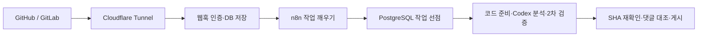

# CodeReviewBot

n8n과 Codex CLI로 GitHub PR·GitLab MR을 리뷰하는 개인 서버용 봇입니다.
버그·보안·회귀·팀 규칙을 검토하고, 같은 양식의 한국어 보고서와 인라인 댓글을 남깁니다.

## 구현된 흐름



- 최신 푸시를 30초간 모으며 최초에는 전체, 이후에는 변경된 파일과 관련 코드를 검토합니다.
- Codex의 셸·브라우저·다른 앱·하위 에이전트 도구를 끄고, 고정 스냅샷 읽기·검색 MCP만 제공합니다.
- Git 쓰기 자격 증명은 컨트롤러에만 있습니다. 실행기는 호스트 홈·Docker 소켓·Git 캐시를 받지 않습니다.
- 생성된 지적은 2차 검증과 실제 diff·코드 위치 검사를 거칩니다. 삭제한 코드의 LEFT 위치도 지원합니다.
- GitHub Checks·커밋 상태와 GitLab pipeline·실패 로그를 읽습니다. 프로젝트 코드·테스트·설치 스크립트는 실행하지 않습니다.
- 하나의 요약 댓글을 갱신하고 기존 지적 ID를 유지합니다. 응답 유실 후에는 댓글을 조회하고 재시도합니다.
- 질문·기각·일시정지·재개와 승인 전에는 적용되지 않는 저장소별 학습을 지원합니다.
- 질문에 대한 답변을 채점·해설하고, `더 알아보자` 요청으로 변경과 연결된 기술 심화 질문을 추가합니다.
- 자동 코드 커밋·승인·머지는 수행하지 않습니다.

## 로컬 개발과 검증

필요한 환경: Node.js 22+, npm, Git. 통합 테스트와 서버 실행에는 Docker/Colima가 필요합니다.
이미지 빌드 전에는 Colima VM 디스크의 여유 공간도 확인하세요. 빌드용 임시 공간을 포함해 8 GiB 이상을 권장합니다.

```sh
npm ci --ignore-scripts
npm test
node scripts/integration.mjs
npm run demo
```

`npm run demo`는 모델 호출 없이 `.local/demo-report.md`, `.local/demo-inline.md`, `.local/demo-learning.md`를 만듭니다.
통합 테스트는 별도의 임시 PostgreSQL 컨테이너를 만들고 종료 후 제거합니다.
Git 플랫폼·모델 응답은 경계 테스트에서 통제된 fixture를 사용하며, 실계정 품질 평가를 대체하지 않습니다.

## 서버 준비

```sh
node scripts/setup.mjs
docker compose build controller runner
docker compose up -d
node scripts/bootstrap-n8n.mjs
node scripts/smoke.mjs
```

설정 스크립트는 내부 토큰·DB 비밀번호를 `.env`에 만들며 기존 값을 보존합니다.
Git 저장소 연결은 기본적으로 비활성화되어 있습니다. 외부 연동은 [연결 가이드](docs/connections.md)를 따라 나중에 진행할 수 있습니다.

- n8n: <http://localhost:5688> — 필요하면 최초 Owner 계정을 설정합니다.
- 컨트롤러 상태: <http://localhost:18092/healthz>
- 내부 API와 DB, 실행기는 외부 웹훅 주소로 노출되지 않습니다.
- n8n dispatch는 10초마다 다음 단계를 수행하고, recovery는 1분마다 누락된 변경과 CI 갱신을 확인합니다.

서버를 멈출 때는 `docker compose stop`을 사용합니다. `down -v`는 인증·DB·n8n 상태를 지우므로 일반 정지에 사용하지 않습니다.

## 고정 리뷰 양식

보고서는 결과·상태·검토 방식·커밋 링크를 한 줄로 표시하고, 아래 네 섹션을 항상 유지합니다.

1. 변경 요약
2. 발견 사항
3. 검증·주의사항
4. 변경 이해 질문

중복된 변경 내역 표, 빈 흐름도, 빈 상태 목록, 긴 파일·규칙 나열과 양식 버전 안내는 표시하지 않습니다.
발견 사항의 상태는 표에서 확인하며, CI 결과·권장 검증·검토 한계는 세 번째 섹션에 모읍니다.
인라인 댓글은 심각도·분류·ID와 **문제 → 발생 조건 → 영향 → 근거 → 수정 방향 → 추천 검증** 순서입니다. 코드 제안은 있을 때만 표시합니다.
AI가 Markdown 구조를 결정하지 않으며, 버전이 있는 JSON Schema와 렌더러가 구조·상태값을 고정합니다.
부분 검토·실패는 `판단 보류`, 실행하지 않은 검사는 `미실행`, 확보하지 못한 정보는 `확인 불가`입니다.
플랫폼 댓글 길이 제한에 걸리면 네 섹션을 유지하면서 내용을 축약하고, 축약 사실과 표시한 지적 수를 밝힙니다.

완료된 리뷰에는 **이번 변경을 이해하는 질문 3~10개**를 관련 코드 링크와 함께 제공합니다.
핵심 동작·불변 조건, 설계 의도·트레이드오프, 실패·경계 상황, 도입한 기술이나 면접형 사고 질문 중 변경에 맞는 주제를 고릅니다.
일반 상식이나 수를 채우기 위한 중복 질문은 제외하며, 답과 해설은 기본 양식에 넣지 않습니다.
질문은 2차 검토를 거쳐 실제 diff 위치와 중복 여부를 검사합니다. 이름만 바뀐 파일은 이동한 소스에 연결하며, 긴 보고서를 축약해도 최소 3개를 유지합니다.
텍스트 코드가 없는 바이너리·제외 파일뿐인 변경은 부분 검토로 표시하고, 질문을 만들 수 없는 이유를 밝힙니다.
실패·진행 중에는 질문을 꾸며 넣지 않습니다. 질문이 없는 기존 보고서는 다음 복구 조회나 `/reviewbot full`로 다시 생성합니다.
CI의 건너뜀·중립 결과는 통과와 구분합니다.
자세한 계약과 완료 기준은 [구현 계약](docs/plan.md), 진행·검증 기록은 [작업 기록](docs/progress.md)에 있습니다.

## 저장소 정책

대상 브랜치의 `.codereviewbot.yaml`을 사용합니다. PR에서 정책을 변경해도 해당 PR의 권한이나 검토 기준을 바로 바꾸지 않습니다.

```yaml
version: 1
maxInlineComments: 5
exclude: ["generated/**"]
pathInstructions:
  - path: "src/controllers/**"
    instructions: "인증·권한·입력 검증을 확인한다."
```

base의 `AGENTS.md`, `docs/coding-standards.md`, 직접 연결된 Git 이슈와 승인된 저장소별 학습도 참고합니다.
생성물·바이너리·에이전트 설정·명백한 인증 파일은 소스 도구에서 제외하고 보고서에 범위를 표시합니다.
컨텍스트는 최대 1,500개 파일·12 MiB·파일당 200 KB, diff는 150 KB로 제한합니다. 자원 제한 때문에 누락되면 부분 검토로 표시합니다.

## 댓글 명령

저장소 Write/Developer 이상 사용자에게 허용합니다. 규칙 승인·거절에는 Maintain/Admin 또는 GitLab Maintainer 이상이 필요합니다.

| 명령 | 동작 |
|---|---|
| `/reviewbot review` | 최신 변경 검토 |
| `/reviewbot full` | 전체 재검토 |
| `/reviewbot pause` / `resume` | 자동 리뷰 일시정지·재개 |
| `/reviewbot explain CRB-0001` | 지적을 다시 확인하고 설명 |
| `/reviewbot dismiss CRB-0001 이유` | 사유를 남기고 해당 PR/MR에서 기각 |
| `@reviewbot 질문` 또는 봇 지적에 답글 | 코드 근거를 확인해 답변 |
| `더 알아보자` / `@reviewbot 더 알아보자` / `/reviewbot questions` | 이번 변경에 연결된 기술 심화 질문 3~10개 추가 |
| `/reviewbot answer Q-ID 내 답변` 또는 `Q-ID: 내 답변` | 해당 질문 채점과 해설 |
| `/reviewbot learn 규칙` | 저장소별 규칙 제안 저장 |
| `/reviewbot approve UUID` / `reject UUID` | 관리자 규칙 승인·거절 |

일반 대화와 기각을 자동으로 전역 규칙으로 만들지 않습니다. 상세 운영·복구는 [운영 가이드](docs/operations.md)를 참고하세요.

## 댓글로 이어가는 기술 학습

각 질문의 실제 `Q-...` ID를 복사해 답합니다. 객관식은 `A` 같은 보기 문자나 답 내용을,
주관식은 설명을 적습니다. 예: `/reviewbot answer Q-0123456789ab B` (ID는 실제 질문 ID로 바꿉니다).
봇은 **정답·부분 정답·오답·판정 보류 → 답변 평가 → 문제 해설 → 보기별 해설(객관식) → 코드 근거** 순서로 응답합니다.
설계 문제는 타당한 대안과 설명을 인정하고, 외부 계약이나 코드 근거가 부족하면 판정을 보류합니다.

`더 알아보자`를 댓글로 남기면 이미 나온 질문을 제외하고 이 변경에서 배울 기술의 원리,
설계 선택, 실패 복구, 동시성, 성능·테스트 전략 등을 더 깊게 묻습니다. 일반 CS 상식으로 수를 채우지 않습니다.
한 번에 3~10개, 같은 코드 버전에서 추가 요청은 PR/MR 전체에 걸쳐 최대 5회입니다. 준비 후 게시 대기 중인 요청도 횟수에 포함합니다.
질문·채점 호출은 각각 최대 2분이며, 질문 생성은 기존 리뷰의 2차 검증과 별도로 한 번 수행한 뒤 스키마·실제 변경 위치·중복을 검사합니다.

GitHub 인라인 리뷰 스레드와 GitLab discussion에서는 같은 스레드에 답글을 답니다.
일반 GitHub PR 댓글에는 요청 댓글 링크를 포함한 새 댓글로 응답합니다. 질문이 하나뿐인 봇 스레드에서는 일반 답글도 채점하며,
여러 질문이 있으면 ID를 지정하도록 안내합니다. 댓글 본문은 최대 8,000자로 제한합니다.
질문은 head·base·start SHA에 묶이며, 코드 기준이 바뀌면 최신 질문으로 다시 답하도록 안내합니다.
같은 코드에서 보고서를 재생성하거나 리뷰가 실패해도 이미 게시한 질문의 ID와 추가 학습 이력은 보존합니다.
