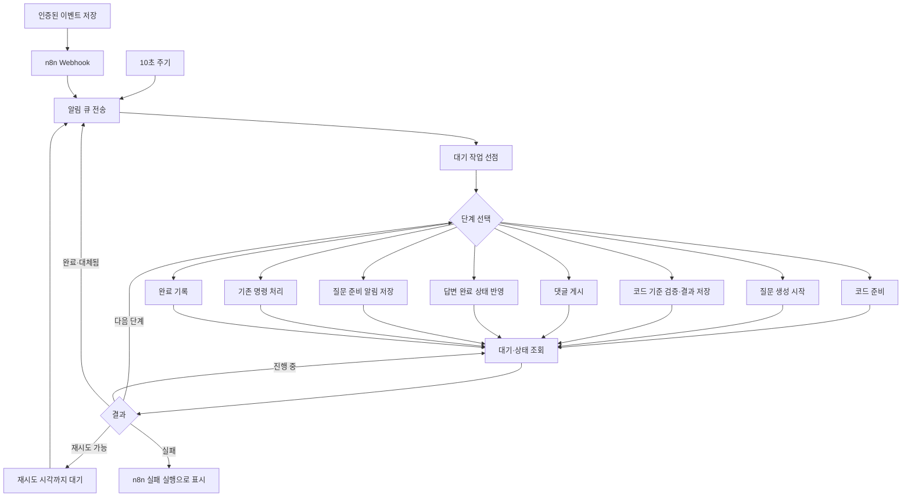

# n8n 단계별 작업 관리

## 역할과 보존 범위

n8n이 작업 선택, 단계 분기, 완료 대기, 재시도 시점과 복구 순서를 관리한다. Controller는 요청받은 한 단계만 실행하고, Runner는 기존 모델 호출을 담당한다. PostgreSQL은 작업·질문·답변·채점·댓글 중복 방지와 실행 소유권을 보존한다.

기존 GMS 설정·프롬프트·최초 기본 질문 2개·심화 질문 5개·120초 모델 제한·6개 명령·스레드별 정답 공개·채점·답변 완료 상태·Mattermost 문구·전송 불확실 상태 정책을 유지한다. 머지 완료와 명시적 재생성에서만 질문을 생성하며, 일반 Push·CI로 새 질문을 만들지 않는다. 외부 웹훅 URL과 n8n 워크플로/자격 증명 ID도 유지한다.

## 실행 흐름



`crbDispatch`는 `hey — job orchestration`으로 표시된다. `Choose job phase`에서 요청할 단계를 고르고, `Wait for phase`와 `Read phase status`에서 실제 완료를 확인한다. HTTP 202 수신을 질문 생성 완료로 간주하지 않는다. 같은 코드에 재사용 가능한 결과가 있으면 생성 단계를 건너뛴다.

`crbRecovery`는 1분마다 답변 완료 상태 대조 → 허용된 실패 작업 재등록 → 오래된 소스 정리 → 알림 큐 전송 순서로 실행한다. 일반 열린 MR의 변경을 새로운 출제 대상으로 발견하지 않는다.

명령은 `Handle command` 단계에서 기존 권한 확인·저장된 답변키·스레드 대조·채점·응답 게시를 수행하고, `Complete job`에서 접수 안내와 요약·답변 완료 상태를 정리한다. 명령 내부의 개별 모델/보기별 채점은 Controller가 유지한다.

## 내부 API

모든 경로는 기존 `Authorization: Bearer INTERNAL_TOKEN` 인증을 요구하며 외부 터널로 공개하지 않는다.

| 경로 | 동작 |
|---|---|
| `POST /internal/flow/claim` | 처리 가능한 작업 1개를 선점하고 ID·실행 소유자·단계·상태 반환 |
| `POST /internal/flow/jobs/:id/step` | `{owner, step}`의 정확한 한 단계만 비동기로 시작, 202 반환 |
| `POST /internal/flow/jobs/:id/status` | `{owner}`로 실제 단계 상태 조회, 대기 단계의 유효한 lease 갱신 |
| `POST /internal/flow/notifications` | 기존 알림 큐의 전송 1회를 기다린 뒤 응답 |
| `POST /internal/flow/reconcile` | 기존 질문의 답변 완료 상태 대조 |
| `POST /internal/flow/recover` | 기존 정책에 맞는 실패 작업만 재등록 |
| `POST /internal/flow/cleanup` | 대기·진행·게시 작업을 보호하며 소스 정리 |

상태 응답에는 ID·소유자·작업 종류·단계·상태·재시도 시각만 포함한다. 소스·프롬프트·질문 본문·답변키·모델 응답은 n8n으로 전달하지 않는다. 잘못된 입력은 400, 이전 소유권이나 순서에 맞지 않는 단계는 409다. 이미 끝난 단계의 재전송은 저장된 상태를 반환한다.

기존 `POST /internal/tick`, `POST /internal/recover`는 인증 후 410을 반환한다. 이전 워크플로와 새 Controller를 섞어 운영하지 않는다. `Controller.tick/perform/recover`는 기존 코드의 회귀 검증과 호환 도우미로 남지만 운영 HTTP 실행 경로는 n8n 단계 API뿐이다.

## 재시작·중복 방지·저장량

- 기존 DB 작업 상태를 그대로 사용하고 `workflow_step`, `workflow_status`, `workflow_owner`, `workflow_data`를 추가한다. 기존 행·보고서·질문·답변을 삭제하거나 재생성하지 않는다.
- 전역 작업 1개, 90초 lease, 실행 중 15초 heartbeat와 소유자 fencing을 유지한다. 다음 단계 실행을 기다리는 pending 상태에서만 n8n의 조회가 lease를 갱신한다. running 단계의 lease는 실행 프로세스의 heartbeat만 갱신하므로, Controller 재시작 후 조회가 고아 작업을 무기한 점유시키지 않는다. n8n/Controller가 사라지면 lease 만료 후 다음 스케줄이 재선점한다.
- 각 단계는 최대 3회 시도한다. 성공한 단계는 재실행하지 않고 실패한 단계부터 이어간다. 생성 결과가 저장된 뒤 게시에 실패하면 모델을 다시 호출하지 않는다. 결과 없이 실패한 질문 작업의 명시적 수동 재시도는 준비부터 다시 시작하므로, 보존 기간이 지난 임시 자료에 의존하지 않는다. 게시 응답 유실은 기존 봇 소유 댓글 마커를 대조한다.
- 소스 준비와 생성 결과의 중간 자료는 기존 snapshots 볼륨의 작업 폴더에 권한 600의 `flow-*.bin`으로 저장한다. 원자적 파일 교체와 DB 체크포인트가 성공한 자료만 다음 단계가 참조한다. 다음 소스 정리에서 기존 보존 정책과 함께 제거한다. DB에는 파일 참조와 작은 단계 이력만 보관한다.
- 외부 모델 호출 직후 체크포인트 기록 전에 프로세스가 중단되면 해당 생성 호출을 다시 해야 할 수 있다. AI 호출의 정확히 1회 실행을 보장하지 않는다. 외부 댓글의 중복 방지는 별도 기존 마커·lease 검증으로 유지한다.
- n8n 성공 실행은 기존 정책대로 보관하지 않고 오류 실행은 48시간·최대 500건만 보관한다. 운영 중 진행은 Executions에서 확인하며, 완료된 작업의 기준 기록은 PostgreSQL이다. 성공 실행의 장기 조회가 필요하면 저장량 정책을 별도로 결정한다.

## 검증

```sh
npm test
node scripts/integration.mjs
node scripts/verify-n8n.mjs
```

마지막 명령은 기존 n8n 2.43.8·PostgreSQL 17 이미지로 독립적인 내부 Docker 네트워크와 일회용 컨테이너를 만들고 종료 시 해당 자원만 삭제한다. 운영 `.env`, 인증 정보, 서버, GitLab/GitHub 및 모델 API에 접근하지 않는다. 서명된 fixture 웹훅 → 실제 n8n 분기·Wait·상태 조회 → 실제 Controller·DB → fixture AI·댓글, 명령 분기와 복구 그래프를 검증한다. 결과는 `.local/n8n-orchestration/runtime.json`에 기록한다.

이 검증에서 주기 트리거는 비활성화하고 인증된 테스트 웹훅으로 시작한다. 복구에는 테스트 전용 트리거를 붙이고 성공 실행을 임시 보관해 실제 실행 노드를 검사한다. 운영 주기와 보관 정책은 변경하지 않는다. 실제 GMS 품질이나 외부 플랫폼 권한은 이 검증의 범위가 아니다.

## 운영 전환과 복구

1. 현재 운영 Compose 설정·이미지·n8n 워크플로를 백업하고 기존 Controller의 작업을 마친다. 웹훅 유입을 잠시 차단하거나 수신 이벤트가 DB에 보존되는지 확인한다.
2. 기존 n8n 워크플로를 비활성화한 뒤 Controller를 새 이미지로 교체한다. Runner의 모델 계약은 바뀌지 않으므로 기존 설정·인증을 유지한다. DB 시작 마이그레이션은 컬럼을 추가하기만 한다.
3. 새 워크플로를 같은 `crbDispatch`·`crbRecovery` ID로 가져와 게시하고 n8n을 재시작한다. 기본 체크아웃은 `node scripts/bootstrap-n8n.mjs`를 사용한다. edo1은 `/home/ubuntu/hey/compose.json`과 실제 프로젝트 이름을 사용하므로 해당 운영 절차에 맞게 실행한다.
4. health·내부 인증·워크플로 활성·단계 실행을 확인한 후 웹훅 처리를 재개한다. 기존 이력과 DB·인증 볼륨은 보존한다.
5. 되돌릴 때는 새 워크플로를 먼저 멈추고 실행 중인 단계를 마친 뒤 이전 Controller 이미지와 이전 n8n 워크플로를 함께 복원한다. 추가된 DB 컬럼을 삭제하지 않는다. 이미 저장된 `jobs.result`와 게시 대기 작업은 이전 코드도 처리할 수 있다. 생성 전에 멈춘 작업은 이전 코드가 준비부터 재실행할 수 있다.

이 문서는 구현·로컬 검증과 운영 전환 절차를 구분한다. 실제 서버 전환 여부는 `docs/progress.md`의 검증 기록을 따른다.


## 운영 적용 결과 · 2026-10-26

edo1에는 수정 커밋 `2dcf0d9`와 `hey-controller:n8n-2dcf0d9`를 적용했다. 작업 관리 22개 노드와 복구 5개 노드의 두 워크플로가 활성화돼 있다. 기존 runner·PostgreSQL·n8n·tunnel 컨테이너, 환경 변수 값, 영속 마운트와 기존 데이터 5개 테이블의 내용 해시를 보존했다.

운영 설정·두 DB·이전 워크플로 백업은 edo1의 `/home/ubuntu/hey/releases/n8n-2dcf0d9`에 제한된 권한으로 보관한다. 해당 위치의 `deploy.py rollback hey-controller:n8n-2dcf0d9`는 이전 Controller와 워크플로를 함께 복원하며 DB를 되돌리거나 추가 컬럼을 삭제하지 않는다. 복사본에서 DB 복원·마이그레이션·이전 이미지 시작과 새·이전 워크플로 등록/게시를 검증했다.

전환 직후 옛 노드 `Dispatch`·`Recover`를 사용한 실행 38006·38007이 폐기된 경로를 호출해 실패했다. 기록은 삭제하거나 성공으로 변경하지 않았다. 이후 실행은 저장된 workflowData의 새 노드를 기준으로 구분했고, 새 구성의 dispatch·recovery 반복 실행과 202 wake 응답, Controller 오류 0건을 확인했다. 성공 보관을 끈 정책 때문에 `status=running`과 `deletedAt`을 함께 확인해야 한다. 실제 모델 호출이나 외부 테스트 댓글은 만들지 않았다.

집계 검증: [운영 적용 증거](verification/n8n-production-2026-10-26.json).
